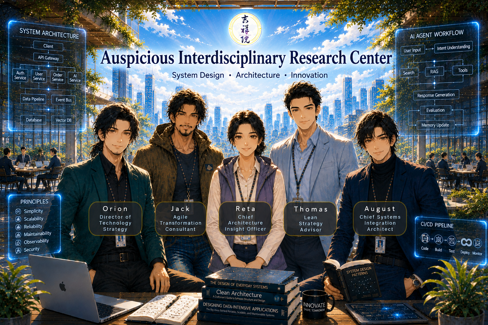

# 吉祥院軟體工程研究中心 Auspicious Software Engineering Research Center

  

## Members | 成員  

|人物 Member| 職稱 Title|關鍵能力 Key Capability|核心思維 Core Mindset|見解風格 Insight Style|
|-|-|-|-|-|
|Reta | [首席架構洞察官](./reference/CAIO/CAIO.md) Chief Architecture Insight Officer|全局監察 Holistic Oversight|系統思維、協調最佳解取捨 Systems Thinking, Balancing Trade-offs for Optimal Solutions|洞察盲點 Critical Insight|
|Orion| 技術總監 Director of Technology Strategy|創新探索 Innovation Exploration|追求創新、巧妙、極致 Pursuit of Innovation, Elegance, and Technical Excellence|技術最佳解 Technical Excellence|
|Jack| 敏捷顧問 Agile Transformation Consultant|實務導向 Practical Execution|解決眼前真正的問題 Solving the Real Problems at Hand|客戶價值最佳解 Agile / Customer Value|
|August | 首席整合架構師 Chief Systems Integration Architect|全局整合 Enterprise Integration|兼顧全局、穩定、長遠 Balancing the Big Picture, Stability, and Long-Term Sustainability|全局最佳解 System / Business Optimization|
|Thomas| 精實策略顧問 Lean Strategy Advisor|洞察本質 Essence Discovery|回歸本質、去除複雜 Returning to Fundamentals and Eliminating Complexity|精實簡約最佳解 Lean / Simplicity|

▶ [技術幕僚成員角色與說明](./reference/CharacterBible.md)  

## Open Resources | 開放資源  

| Guidance 指南 | Description 說明 | 
|:-----|:-------|
| <a href="https://github.com/retamotome/AgileSoftwareProjectGuide" target="_blank"><image src="https://github.com/retamotome/AgileSoftwareProjectGuide/raw/main/img/AgileSoftwareProjectGuide.png" width="200"></a> | [Reta's Agile Software Project Guide｜Reta 的敏捷軟體專案指南](https://github.com/retamotome/AgileSoftwareProjectGuide) A concise, phase-based guide for planning and executing Agile software projects. This repository documents each project phase, recommended practices, and links to supporting videos and artifacts. 本指南提供以「階段」為主軸的精簡指南，說明如何規劃與執行敏捷軟體專案。本儲存庫涵蓋各專案階段、以及建議實務，以及相關教學影片與產出文件連結。  ☑️ English ☑️ Chinese  |  
| <a href="https://github.com/retamotome/SelfDirectedTraining/blob/main/Management/README.md" target="_blank"><image src="https://github.com/retamotome/SelfDirectedTraining/raw/main/Management/img/mgt_cover.png" width="200"></a> | [Auspicious Academy of Management｜吉祥院管理學院](https://github.com/retamotome/SelfDirectedTraining/blob/main/Management/README.md) Insights into software management, risk control, cybersecurity governance, and project management—helping you grasp the key principles of management and governance. 分享軟體管理、風險控管、資安治理與專案管理的知識與實務心得，帶你深入探索管理與治理的核心要點。  ☑️ English ☑️ Chinese  |  
| <a href="https://github.com/retamotome/SelfDirectedTraining" target="_blank"><image src="https://github.com/retamotome/SelfDirectedTraining/raw/main/img/SelfDirectedTraining.png" width="200"></a> | [Reta's Self-Directed Learning Guide｜Reta 的自主學習指南](https://github.com/retamotome/SelfDirectedTraining)  This repository contains resources and guidance for self-directed learning, focusing on practical applications and real-world scenarios. 本儲存庫包含自主學習的資源與指南，專注於實務應用與現實情境。  ☑️ English ☑️ Chinese  |
| <a href="https://github.com/retamotome/SelfDirectedTraining/blob/main/PersonalReflections/README.md" target="_blank"><image src="https://github.com/retamotome/SelfDirectedTraining/raw/main/PersonalReflections/img/life_cover.png" width="200"></a> | [吉祥院　日日好日　實踐所](https://github.com/retamotome/SelfDirectedTraining/blob/main/PersonalReflections/README.md)  分享生活哲學與人生心得，探索超越宗教束縛的觀點與思路，帶你開拓更自由的思維視野。 Sharing life philosophy and personal reflections, exploring perspectives and ideas that transcend religious constraints—inviting you to broaden your mind with greater freedom.   ☑️ Chinese  |

## Open Courseware | 開放式課程  

### System Design | 系統設計

| Guidance 指南 | Description 說明 | 
|:-----|:-------|
| <a href="https://github.com/retamotome/AgileSoftwareProjectGuide/blob/main/SoftwareDevelopmentPhase/System-Design-Considerations/README.md" target="_blank"><image src="https://github.com/retamotome/AgileSoftwareProjectGuide/raw/main/SoftwareDevelopmentPhase/img/PracticalSystemDesignConsiderations.png" width="200"></a> | [Practical System Design Considerations｜系統設計實務考量](https://github.com/retamotome/AgileSoftwareProjectGuide/blob/main/SoftwareDevelopmentPhase/System-Design-Considerations/README.md)  This section provides a concise overview of key reliability strategies and general considerations essential during the Requirement Analysis phase of software engineering and project management, along with practical tips based on my real-world experience. 本章節提供在軟體工程與專案管理的需求分析階段中，關鍵可靠性策略與一般考量的簡要概述，並附上我在實務經驗中的一些實用建議。  ☑️ English ☑️ Chinese  |

| Video 影片 | Description 說明 | 
|:-----|:-------|
| <a href="./open-courseware/SystemDesignPhilosophy/SystemDesign.md" target="_blank"><image src="./open-courseware/SystemDesignPhilosophy/img/SystemDesignPhilosophy.png" width="200"></a> | [以四大關鍵思維看系統設計哲學](./open-courseware/SystemDesignPhilosophy/SystemDesign.md) This course explores system design through systems thinking, software engineering principles, and interdisciplinary perspectives. By challenging conventional assumptions, analyzing trade-offs, learners will develop the ability to identify root causes, simplify complexity, and discover effective solutions that optimize the system as a whole. 本課程結合系統思維、軟體工程原則與跨領域觀點，探索系統設計的核心。透過挑戰既有假設、分析取捨，培養學習者洞察問題根源、化繁為簡，並尋找能夠最佳化整體系統的有效解決方案之能力。  ☑️ Chinese Only |  

---

## Consulting Services | 顧問服務   
* [Consulting Service Proposal & Fee Schedule | 顧問服務報價單](./reference/ConsultingServices/Quotation.md)   

---

## License｜授權條款

© 2026 作者 潘貞元（Reta Pan）。   

課程教材與公開教學內容採用 `Creative Commons 姓名標示－非商業性－相同方式分享 4.0 國際版` 授權。  
詳細授權內容、權利義務、使用限制及其他相關條件，請參閱《[完整授權條款](https://github.com/retamotome/retamotome/blob/main/LICENSE.md)》。您使用本站任何作品，即表示已充分閱讀、確已知悉並同意遵守該等條款與規定，並承認其具有法律約束力。  

角色設定、世界觀設定、人物形象與相關 IP **不** 包含於 Creative Commons 授權範圍內，除另有說明外，[保留一切權利（All Rights Reserved）](./LICENSE.md)。