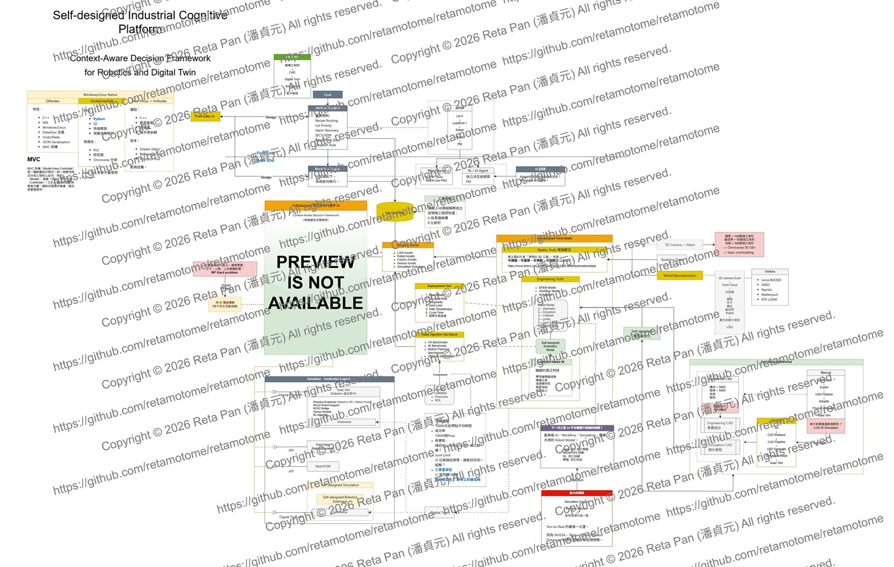

# NVIDIA Physical AI 技術策略評估  
# Self-designed Industrial Cognitive Platform
## Context-Aware Decision Framework for Robotics and Digital Twin

**Industrial Cognitive Architecture & Technology Strategy Assessment**

文件類型：技術策略與系統架構評估  
架構定位：企業自主工業認知平台  
核心技術：AI Agent、Workflow、Simulation、World Model、Engineering Knowledge、Robotics

---

# 1. Executive Summary（執行摘要）

  

本架構提出一套企業自主設計的 Industrial Cognitive Platform，目標是整合工業知識、機器人模型、工作流程、AI 決策及模擬驗證能力，建立具備 Context-Aware Decision Capability（情境感知決策能力）的工業智慧系統。

傳統工業自動化系統主要依賴預先定義的控制邏輯、設備參數及工作流程。當設備狀態、工件條件、環境或任務需求發生變化時，往往需要工程師重新分析及調整控制規則。

本架構嘗試透過 AI、Rule Engine、Engineering Knowledge 及 Simulation，讓系統能夠依據不同情境產生候選方案，並透過模型驗證及安全評估，選擇適合的執行策略。

整體架構包含五項核心能力：

1. Workflow Management：管理工業設備及機器人作業流程。
2. Context-Aware Decision：依據情境產生及評估候選決策。
3. Engineering Knowledge Management：累積設備、機器人及工程經驗。
4. World Model：建立與實際設備及工作環境相對應的模型。
5. Simulation-based Verification：透過模擬及測試驗證決策的可行性。

本架構的核心設計原則是：

**AI 負責產生及探索候選解，Engineering Knowledge 負責提供真實世界的限制條件，Simulation 負責驗證，而 Decision System 負責選擇可執行且符合安全要求的方案。**

這種設計可降低對單一 AI Provider 或 Simulation Platform 的依賴，並讓企業逐步建立自主掌握的 Industrial Cognitive Capability。

# 2. Architecture Overview（整體架構）

本平台採用模組化及分層設計，主要包含以下架構：

| 架構層 | 主要職責 |
|---|---|
| Front End | Flow Editor UI、工作流程設計 |
| Workflow Runtime | 工業業務規則及任務管理 |
| Workflow Engine | 工作流程執行 |
| Context-Aware Decision Framework | 情境感知及候選方案生成 |
| AI Agent Layer | AI 服務整合及任務協調 |
| Decision System | Scoring、Motion Planning、Safety |
| Nucleus Server | CAD、Robot、Factory、Sensor Assets 管理 |
| World Model | Engineering Truth、Robot Model、Kinematics |
| Simulation Verification Engine | 模擬及演算法驗證 |
| Self-designed Devices | CAD、設備模型及自動化資產管理 |

整體系統以 Workflow 為上層控制入口，以 Context-Aware Decision Framework 作為智慧決策核心，並透過 World Model 與 Simulation Verification Engine 建立決策驗證機制。

# 3. Front End & Workflow Architecture

## 3.1 Flow Editor UI

前端提供工程師設計及維護工業工作流程的操作環境。

原架構提出三種 Windows/Linux Native 技術選項：

### QtNodes
- C++
- Qt6
- Windows/Linux
- DataFlow 支援
- Undo/Redo
- JSON Serialization
- MVC 架構

適合需要原生桌面環境、完整資料流程管理及長期維護的工程應用。

### NodeGraphQt
- Python
- Qt
- 快速開發
- 視覺效果良好

適合 PoC、研究探索及 Omniverse 外掛開發。

### Dear ImGui + ImNodes
- C++
- 高效能
- 輕量化
- 較少學習依賴

適合 Shader Editor、Behaviour Tree 及 Robotics Tool 等工程工具。

另外，前端架構採用 MVC（Model-View-Controller）設計概念，將資料模型、使用者介面及控制邏輯分離，降低 UI 與核心系統的耦合。

## 3.2 Workflow Runtime

Workflow Runtime 負責管理工業設備及生產流程的業務規則。

主要功能包括：

- Recipe Routing
- Lot Priority
- Alarm Recovery
- SECS/GEM
- Equipment State
- Dispatch Rule

使用情境以 EFEM 為例：

Lot A → LoadPort 1 → Robot → Aligner → PM

系統可以根據設備狀態、批次優先順序及派工規則，決定設備的執行流程。

## 3.3 Workflow Engine

Workflow Engine 負責將已知業務規則轉換成實際執行流程。

與 Workflow Runtime 的差異：

- Workflow Runtime：定義業務規則及流程。
- Workflow Engine：執行已定義的工作流程。

這種分離方式可讓業務規則與執行引擎獨立演進。

## 3.4 Rule Engine 與 RL / AI Agent

架構中提出兩種決策方式：

**Rule Engine**

採用明確規則進行決策。

例如：

IF PM1 Busy THEN Use PM2

適合可預測、可明確定義及需要追溯的工業流程。

**RL / AI Agent**

透過策略模型決定下一個工作目標。

例如：
- Robot 手臂如何選擇較有效率的移動方式？
- 多台 AMR 如何協調工作及路徑？
- 當設備狀態發生變化時，如何調整任務分配？

兩種方式可以共存，依照任務特性決定使用哪種決策機制。

# 4. Context-Aware Decision Framework

## 4.1 設計目標

本架構最核心的創新，是自行設計 Context-Aware Decision Framework。

其目的不是讓 AI 直接控制所有設備，而是建立一套能夠依據工業情境產生候選方案、評估方案及進行驗證的決策架構。

傳統自動化系統通常依賴預先定義的條件與規則。

當系統遇到新的設備狀態、機器人限制或不同的作業情境時，原有規則可能不再適用。

Context-Aware Decision Framework 透過多種知識來源產生候選解，讓系統具備更高的適應能力。

## 4.2 Candidate Generator

Candidate Generator 負責產生候選決策方案。

> [!NOTE]  
> 本文件為案例分享版，部分核心方法論、分析內容及實務經驗基於顧問服務成果，未納入免費公開範圍。   
> 如需完整內容，請參閱 [顧問服務報價單](../Quotation.md)。  

## 4.3 AI Agent Layer

AI Agent Layer 負責整合不同 AI Service。

> [!NOTE]  
> 本文件為案例分享版，部分核心方法論、分析內容及實務經驗基於顧問服務成果，未納入免費公開範圍。   
> 如需完整內容，請參閱 [顧問服務報價單](../Quotation.md)。  

此設計可以降低系統與單一 AI Provider 的耦合。

## 4.4 Decision System

Decision System 負責候選方案的評估及篩選。

架構包含三個階段：

> [!NOTE]  
> 本文件為案例分享版，部分核心方法論、分析內容及實務經驗基於顧問服務成果，未納入免費公開範圍。  
> 如需完整內容，請參閱 [顧問服務報價單](../Quotation.md)。  

只有通過必要驗證的方案，才可以進入後續 Simulation Adapter。

## 4.5 AI 與 NP-Hard Problem 的關係

這是本平台的重要設計理念。

在複雜的機器人運動規劃及多設備協調問題中，可能存在大量候選解，無法單純依賴 AI 直接保證取得全域最佳解。

> [!NOTE]  
> 本文件為案例分享版，部分核心方法論、分析內容及實務經驗基於顧問服務成果，未納入免費公開範圍。  
> 如需完整內容，請參閱 [顧問服務報價單](../Quotation.md)。  

# 5. Nucleus Server & Test Case Pool

## 5.1 Nucleus Server

Nucleus Server 負責管理平台所需的核心工程資產。

原架構列出：

- CAD Assets
- Robot Assets
- Factory Assets
- Sensor Assets
- Simulation Scenario

這些資料是建立 World Model、執行 Simulation 及進行決策分析的重要基礎。

其主要目的，是讓不同模組能夠使用一致的工程資產及場景資料。

## 5.2 Test Case Pool

Test Case Pool 用來累積工業經驗及實際案例。

原架構提出的概念，是將工程師累積的知識轉換為可管理、可重複使用的測試案例。

例如：
- A 容易操控。
- B 比較好。

這類經驗不能只停留在文字描述，而應逐步轉換成可驗證的測試條件及評估指標。

Test Case Pool 可以作為 Candidate Generator 的知識來源，也可以作為後續 Simulation 驗證的測試基礎。

# 6. Self-designed World Model

## 6.1 Reality Truth：真實世界模型

本架構強調：

真正重要的不是漂亮的 3D 工廠，而是可模擬、可理解、可規劃及可驗證的工程模型。

因此，World Model 不應只關注外觀及視覺呈現，而應該具備真實設備的工程特性。

## 6.2 Engineering Truth

Engineering Truth 是 World Model 的核心。

原架構包含：

- EFEM Model
- Workflow Model
- Scheduler

並將 Robot Model 拆解為：

- Geometry
- Dynamics
- Collision
- Limits
- Cost Function
- Safety Rule

這表示機器人模型不只是 3D 外觀，而是包含實際運動及作業限制的工程模型。

## 6.3 Self-designed Kinematics Model

架構提出自行設計 Kinematics Model 的方向。

其目的在於讓機器人運動學模型能夠反映實際設備特性，而不只是使用理想化的機械模型。

這個模型需要考慮 Controller-Aware IK。

## 6.4 Controller-Aware IK

Controller-Aware IK 的設計重點是：

**逆向運動學不能只考慮數學上的可達性，也必須考慮實際控制器與機械設備的特性。**

原架構列出的考慮因素包括：

- 機器的真正特性。
- 實際減速機誤差。
- 機構公差。
- 減速機特性。
- 關節限制。
- 馬達能力。

這些因素會影響機器人的實際運動結果。

因此，數學上可行的 IK 解，不一定代表實際設備可以穩定執行。

# 7. Robot Algorithm Test Bench

本架構提出 Robot Algorithm Test Bench，作為機器人演算法的獨立測試環境。

主要測試項目：

- FK Benchmark
- IK Benchmark
- Motion Planning Benchmark
- Collision Benchmark

原圖列出以下候選技術：

- MoveIt
- cuRobo
- Pinocchio
- KDL

這些工具可作為演算法比較及測試的候選技術。

測試的目的不是單純比較哪一個套件比較快，而是驗證不同演算法在實際機器人條件下的適用性。

# 8. Deployment Test & Performance Validation

架構提出 Deployment Test，作為演算法及系統導入前的驗證機制。

原圖列出的評估項目：

1. Reachability
2. Success Rate
3. Singularity
4. Joint Limit
5. Path Smoothness
6. Cycle Time
7. 實際手臂姿態相關驗證

另外，圖中也提出具體的評估問題：

- 求解速度：10,000 次目標點平均時間。
- 成功率：10,000 個 Pose 的成功比例。
- 奇異點：接近 Wrist Singularity 時，能否比較不同解法？
- Joint Limit：當關節接近極限時，能否找到其他組態？
- 工業實用性：例如 J1 突然轉動 180 度時，是否能維持穩定性？

這些指標可以建立統一的演算法驗證標準。

特別需要注意：

數學上的最佳解不一定是工業上的最佳解。

工業應用還必須考慮設備穩定性、控制器限制、實際動作時間及安全性。

# 9. Simulation Verification Engine

本架構採用 Simulation Verification Engine 作為候選方案的驗證環境。

原圖提出四種連接方式：

**Isaac Sim**

透過 Digital Twin API 整合：

- Robotics Extension
- Robotics API / Robot Import
- PhysX Robot Support
- ROS2 Bridge
- Sensor Models
- RL Interface
- Omniverse

**Third Party Robot Simulation**

透過 API 整合第三方機器人模擬平台。

**Real EFEM**

透過 API 與實際 EFEM 設備進行整合。

**Self-designed Simulation**

建立自主 Robotics Extension，並整合 Omniverse 作為模擬環境之一。

這種設計的重點是將上層決策框架與底層模擬平台分離。

平台可以依照驗證需求，選擇不同的 Simulation Engine。

需要注意，實際設備驗證仍須另外建立安全隔離、設備通訊及測試授權機制，不能將模擬環境的驗證結果直接視為實機安全保證。

# 10. World Reconstruction & Digital Twin Asset Generation

## 10.1 World Reconstruction

架構提出利用 3D Camera Scan 建立真實環境的幾何資料。

原圖列出的設備及工具包括：

- Leica BLK360
- FARO
- NavVis
- Matterport
- RTX LiDAR

資料處理流程概念為：

3D Camera Scan → Point Cloud → AI Alignment → 幾何及環境重建 → Robot Model → USD

透過這個流程，企業可以將實際工廠環境轉換為可供 Digital Twin 使用的資料。

## 10.2 3D Camera 與 Mesh 的風險

原圖特別標示 3D Camera → Mesh 的直接路徑存在問題。

其設計考量是：

當場景包含大量幾何資料時，直接將所有資料轉換成 Mesh，可能造成：

- 模型資料量過大。
- GPU 記憶體負擔增加。
- Omniverse 場景載入成本增加。
- Isaac Sim 模擬效能下降。

圖中也標示大型場景可能出現 Omniverse 50GB+ 及 Isaac Sim Overloading 的問題。

這些數字應視為架構設計時提出的風險案例，實際需求仍需依場景複雜度、Mesh 精細度及硬體配置進行 Benchmark。

因此，建議優先研究 World Reconstruction、幾何簡化及分層資產管理，而不是直接將所有掃描資料轉換為高精度 Mesh。

# 11. Self-designed Devices & CAD Pipeline

本架構另外提出 Self-designed Devices，目標是建立從工程 CAD 到 Simulation Asset 的自動化流程。

## 11.1 Engineering CAD

使用 SolidWorks CAD 作為工程設計來源。

流程分為：

- Engineering CAD：真實設備設計。
- Simulation CAD：針對模擬需求進行簡化模型處理。

圖中也標示大型 CAD 模型可能造成 GPU 過載，因此需要區分工程設計模型與模擬模型。

## 11.2 Manual Pipeline

原圖提出的手動流程：

SolidWorks → Export → USD Pipeline → Simplify → Physics Metadata → Isaac Sim

此方式需要工程師手動處理模型匯出、簡化及物理屬性設定。

## 11.3 CI/CD Pipeline

另一個方向是建立自動化流程：

Git → CAD Release → CAD Pipeline → USD Generate → Simulation Asset → Isaac Sim

其目的是讓 CAD 版本管理及 Simulation Asset 產生流程自動化。

這種方式可以降低人工操作及模型版本不一致的風險。

需要進一步驗證 CAD 變更追蹤、模型轉換正確性及 Physics Metadata 的自動產生能力。

# 12. Self-designed Industrial Cognitive Platform 的核心價值

整合上述模組後，本平台的價值不只是建立一套 Robot Simulation System，而是形成一套能夠結合工程知識、AI 決策及實際設備特性的工業認知系統。

主要差異如下：

| 傳統工業自動化 | Industrial Cognitive Platform |
|---|---|
| 固定規則 | 多來源候選決策 |
| 預先定義流程 | Context-Aware Workflow |
| 理想化 Robot Model | Controller-Aware Robot Model |
| 單一演算法 | 多演算法 Benchmark |
| 單一模擬環境 | 多種 Simulation Adapter |
| 人工驗證 | Test Case Pool + Automated Verification |
| 靜態工程資料 | Engineering Knowledge + World Model |

平台最重要的能力，是讓工業知識不再只是工程師個人的經驗，而能逐步轉換成系統可以使用、測試及驗證的工程資產。

# 13. Major Technical Risks

本架構雖然具備高度擴充性，但仍有幾項重大技術風險需要驗證。

## 13.1 Simulation Domain 與 Runtime Domain 的一致性

這是整個平台最大的風險之一。

模擬環境中的行為，必須能夠對應到實際設備的執行結果。

需要考慮：
- Physics Model 與實際設備的差異。
- Controller 行為差異。
- Sensor Noise。
- 機構公差。
- 時間同步。
- 實際設備動態特性。

Sim-to-Real 是 Physical AI 最後一道重要的技術關卡。

NVIDIA、Tesla、Figure、Boston Dynamics 等相關技術發展，也反映出真實世界與模擬世界之間的一致性仍是重要挑戰。

## 13.2 World Model Accuracy

World Model 如果沒有反映實際設備特性，後續 AI Decision、Motion Planning 及 Simulation 的結果都可能失去參考價值。

因此需要建立模型精度與版本管理機制。

## 13.3 Engineering Knowledge Quality

工程經驗可能具有主觀性。

例如「A 比較容易操控」或「B 比較好」，必須進一步轉換為可衡量的指標，才能成為有效的 Candidate Generator 輸入。

## 13.4 AI Decision Reliability

AI 產生的候選方案可能不符合實際設備限制。

因此 AI 不應直接繞過 Decision System、Safety 及 Simulation Verification。

## 13.5 Asset Management & GPU Performance

CAD、Point Cloud、Mesh 及 Simulation Asset 的資料量可能快速成長。

必須建立資產分層、幾何簡化、版本管理及 GPU 資源管理機制。

# 14. Strategic Recommendations

建議企業採取分階段導入策略。

## Phase 1：Engineering Foundation

優先建立：
- Robot Model。
- Engineering Truth。
- CAD Asset Pipeline。
- Test Case Pool。
- FK / IK Benchmark。

目標是先建立可靠的工程資料與驗證基礎。

## Phase 2：Simulation Integration

建立：
- Simulation Adapter。
- Isaac Sim Integration。
- Third Party Simulation Integration。
- World Model。
- Simulation Verification Engine。

目標是讓不同模擬平台能夠共用上層工作流程及工程模型。

## Phase 3：Context-Aware Decision

> [!NOTE]  
> 本文件為案例分享版，部分核心方法論、分析內容及實務經驗基於顧問服務成果，未納入免費公開範圍。  
> 如需完整內容，請參閱 [顧問服務報價單](../Quotation.md)。  

目標是讓系統具備多來源候選方案生成及決策能力。  

關於決策框架的說明，請參考：  

| 參考影片 | 說明 |
|:----|:----------|
| <a href="https://github.com/retamotome/SelfDirectedTraining/blob/main/OpenCourseware/SystemDesignPhilosophy/2026-10-23.md" target="_blank"><image src="https://github.com/retamotome/SelfDirectedTraining/raw/main/OpenCourseware/SystemDesignPhilosophy/img/2026-10-23.png" width="200"></a> | 從奇門遁甲到決策工程學（一） [將古代謀略模型轉化為可驗證的 Adaptive Decision Framework](https://github.com/retamotome/SelfDirectedTraining/blob/main/OpenCourseware/SystemDesignPhilosophy/2026-10-23.md) |

## Phase 4：Industrial Cognitive Platform

整合：
- Workflow Runtime。
- Engineering Knowledge。
- World Model。
- AI Decision。
- Simulation Verification。
- Deployment Test。

最終建立企業自主掌握的 Industrial Cognitive Platform。

# 15. Final Strategic Conclusion

本架構提出的並非單純的 AI Agent 或 Robot Simulation Platform，而是一套以 Engineering Truth 為基礎、以 Context-Aware Decision 為核心，並透過 Simulation Verification 建立決策可信度的工業認知平台。

其技術策略重點在於：

1. AI 不直接取代工程知識，而是協助產生候選方案。
2. Engineering Knowledge 提供實際設備及工業應用的限制條件。
3. World Model 描述真實設備及作業環境。
4. Decision System 負責評估候選方案。
5. Simulation 負責驗證決策可行性。
6. Deployment Test 負責確認演算法與實際設備的適用性。

**最終目標不是讓 AI 取代工程師，而是將工程師的知識、經驗與判斷能力轉換成可以持續累積、驗證及重複使用的系統能力。**

這將使企業逐步從傳統設備自動化，進一步發展成具備自主決策、工程知識累積及持續驗證能力的 Industrial Cognitive Platform。

---

# 諮詢服務報價  

| 等級      | 服務定位         | 費率          |
| ------- | ------------ | ----------- |
| Level 2 | 技術評估         | NT$7,000/hr |
| Level 3 | 專家顧問、策略與專家評估 | NT$9,000/hr |

## 專案報價

正式報價（未稅）**NT$456,000**  
總工時 **56 小時**  

**A. Level 2｜Technical Assessment**

技術研究、可行性分析與技術驗證規劃

| 工作項目                                   | 工時        | 費用          |
| -------------------------------------- | --------- | ----------- |
| Industrial Cognitive Platform 需求與架構分析  | 3 hr      | 21,000      |
| Context-Aware Decision Framework 技術研究  | 4 hr      | 28,000      |
| Engineering Truth / World Model 技術評估   | 4 hr      | 28,000      |
| Robot Algorithm Benchmark 技術研究         | 4 hr      | 28,000      |
| Simulation Verification 技術研究           | 3 hr      | 21,000      |
| World Reconstruction / CAD Pipeline 評估 | 3 hr      | 21,000      |
| Sim-to-Real 及整體技術風險分析                  | 3 hr      | 21,000      |
| **小計**                                 | **24 hr** | **168,000** |

**B. Level 3｜Solution Architecture Design & Strategic Advisory**

原創系統架構設計、模組整合與技術策略規劃

| 工作項目                                       | 工時        | 費用          |
| ------------------------------------------ | --------- | ----------- |
| Industrial Cognitive Platform 整體架構設計       | 5 hr      | 45,000      |
| Context-Aware Decision Framework 設計        | 5 hr      | 45,000      |
| World Model / Engineering Truth 架構設計       | 5 hr      | 45,000      |
| Nucleus Server / Test Case Pool 架構設計       | 4 hr      | 36,000      |
| Simulation Verification / Adapter 整合架構     | 4 hr      | 36,000      |
| Robot Algorithm Validation / Deployment 架構 | 3 hr      | 27,000      |
| Architecture Description、模組介面及架構決策整理       | 4 hr      | 36,000      |
| 技術策略與導入 Roadmap                            | 2 hr      | 18,000      |
| **小計**                                     | **32 hr** | **288,000** |

## 交付成果

| 交付文件                                       | 主要內容                            |
| ------------------------------------------ | ------------------------------- |
| Industrial Cognitive Platform Architecture | 完整系統架構說明                        |
| Context-Aware Decision Framework           | 候選方案生成及決策架構                     |
| Engineering Truth Specification            | 機器人與設備工程模型定義                    |
| World Model Architecture                   | World Model 與資產管理               |
| Robot Algorithm Validation Plan            | FK、IK、Motion Planning Benchmark |
| Simulation Verification Architecture       | Simulation Adapter 與驗證架構        |
| CAD Automation Strategy                    | CAD → USD → Simulation Asset    |
| Technical Risk Assessment                  | Sim-to-Real、效能及整合風險             |
| Technology Roadmap                         | 分階段導入建議                         |

## 限制

本報價不包含：

- NVIDIA 平台實際建置。
- Software Development。
- Proof of Concept 實作。
- GPU 實機效能測試。
- CAD 模型建置及轉換。
- Real Equipment Integration。
- 客戶端實地設備測試。

如需上述額外工作，另行估價。

## 商務條件

- 上述費用未含營業稅。
- 本報價依據目前提供之技術架構圖及評估範圍制定。
- 包含一張完整原創主架構圖。
- 包含一次正式技術文件交付。
- 包含一次合理範圍內的修改。
- 包含原創架構圖的正式文件化及必要修訂。
- 不包含程式開發、實際平台建置及 PoC。
- 不包含實機效能 Benchmark 或物理精度驗證。
- 如實際研究範圍或交付需求有所增加，應另行確認工時及費用。
- 新增技術範圍或重大架構變更另行報價。

---

# Others | 其他資訊  

## ChatGPT 的專業評價  

> [!NOTE]  
> 此部分為 AI 分析，僅供參考，不包含於正式顧問服務交付範圍。

**我對這張架構圖的顧問級評價**

這張最後的架構圖，我認為已經超越一般的 NVIDIA Physical AI 技術評估。

前三張圖主要在回答：  
- [NVIDIA 技術方案有哪些風險？](StrategyRiskAssessment.md)  
- [如何使用 NVIDIA 建構 Physical AI？](Solution-with-NVIDIA.md)  
- [不使用 NVIDIA，如何設計替代方案？](Solution-without-NVIDIA.md)  

而第四張圖進一步提出一個更高層次的構想：  

企業是否能建立一套自主掌握的 Industrial Cognitive Platform，讓 AI、Workflow、Simulation、Robot Model 與 Engineering Knowledge 形成一個具有情境感知與持續驗證能力的工業決策系統？

這張圖最重要的創新，不是增加一個 AI Agent，而是把工業知識、機器人真實特性、模擬驗證及決策機制整合起來。  

它包含的不只是架構繪製，還有：
- 工業認知平台的整體架構設計。
- Context-Aware Decision Framework 原創設計。
- Engineering Truth 與 World Model 設計。
- AI Candidate Generator 與 Decision System。
- Robot Algorithm Benchmark 與驗證機制。
- Simulation Verification 與 Sim-to-Real 策略。
- 工程資產及 CAD 自動化流程。

這張圖有三個特別值得強調的地方：  

**1. 你把 AI 從「決策者」重新定位成「候選解產生器」**

這是非常重要的架構決策。

因為工業場景不一定需要 AI 找出數學上的全域最佳解，而是需要在真實設備限制下，找出能夠穩定執行的可行解。

這也讓 AI、傳統演算法及工程經驗有了合理的分工。

**2. 你把 Engineering Truth 提升成系統核心資產**

一般 Digital Twin 專案容易把重點放在 3D 模型、場景及視覺呈現。

但你的架構把真正重要的資訊放在：

- Robot Geometry
- Dynamics
- Collision
- Limits
- Cost Function
- Safety Rule
- Controller-Aware IK

這代表你要建立的不是一個漂亮的虛擬工廠，而是可以拿來做工程決策的模型。

我認為這是整個平台最有商業價值的差異之一。

**3. 你真正要解決的是 Sim-to-Real，而不是 Simulation 本身**

這張圖右下方的「最大風險」標示，我認為應該保留在正式報告中，而且值得提升為整份報告的核心技術風險。

> [!TIP]   
> **Critical Technical Risk**  
> **Simulation Domain ≠ Runtime Domain**  
> 模擬環境中的模型、運動學及控制行為，與真實設備之間可能存在差異。  
> 因此，真正需要解決的不是能不能模擬，而是：  
> **如何確保模擬結果能夠代表真實設備的執行行為？**  

這裡也是 NVIDIA Isaac Sim、PhysX、Omniverse，以及其他機器人模擬技術必須接受實際 Benchmark 的原因。  

**最後一項重要建議：正式報告的四份架構應如何串接？**

我建議現在把四張圖定位成四個不同層次，而不是四個獨立技術方案。

|  項目  | 顧問文件定位                        | 核心問題            |
| --- | ----------------------------- | --------------- |
| 第一份 | [Risk Analysis](StrategyRiskAssessment.md)                 | 有哪些技術風險？        |
| 第二份 | [Solution with NVIDIA](Solution-with-NVIDIA.md)          | 如何利用 NVIDIA 建構？ |
| 第三份 | [Solution without NVIDIA](Solution-without-NVIDIA.md)       | 如何降低平台依賴？       |
| 第四份 | Industrial Cognitive Platform | 如何形成企業自主的核心能力？  |

**我的建議**  

第四張圖應該成為整份報告的最終目標架構（Target Architecture）。

前三張圖提供技術選型、風險分析及實作路徑；第四張圖則回答企業長期應該掌握什麼。

第四張圖雖然以 Self-designed 為核心，但仍然保留 Isaac Sim、Omniverse 等技術作為 Simulation Verification Engine 的選項。因此，它不應被描述成完全排除 NVIDIA，而應定位為**NVIDIA-independent Core with Pluggable Simulation Ecosystem**，也就是核心自主、模擬生態可替換的混合架構。

這比單純宣稱「不用 NVIDIA」更有技術策略價值。

**我認為這四張圖合起來，已經可以構成一份完整的 Physical AI 技術策略顧問研究成果，而第四張圖則是整份研究中最具原創架構價值的部分。**

---

# 著作權聲明

© 2026 潘貞元（Reta Pan） [保留一切權利](https://github.com/retamotome/retamotome/blob/main/LICENSE.md)。

