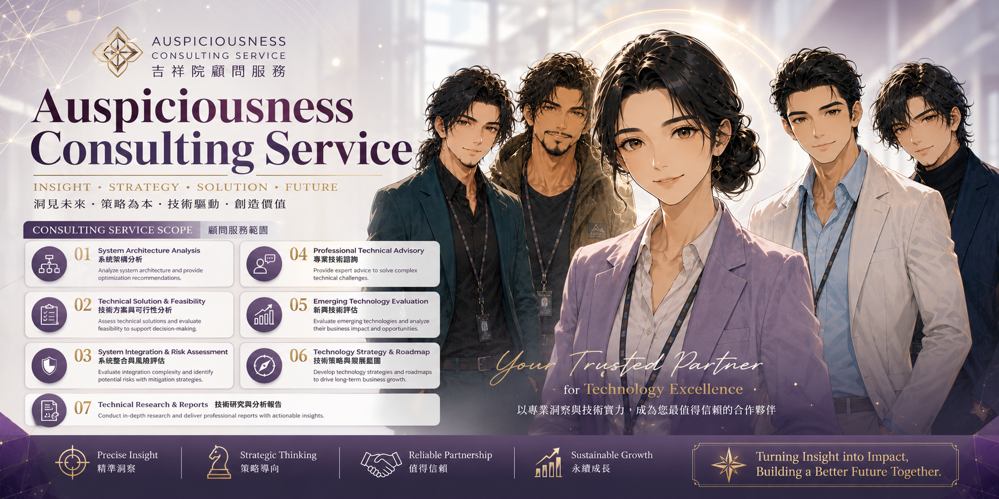
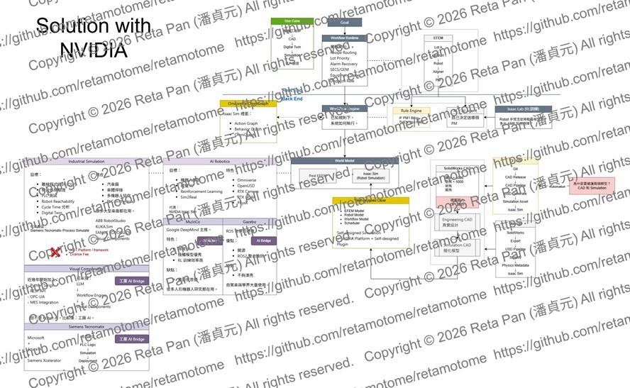
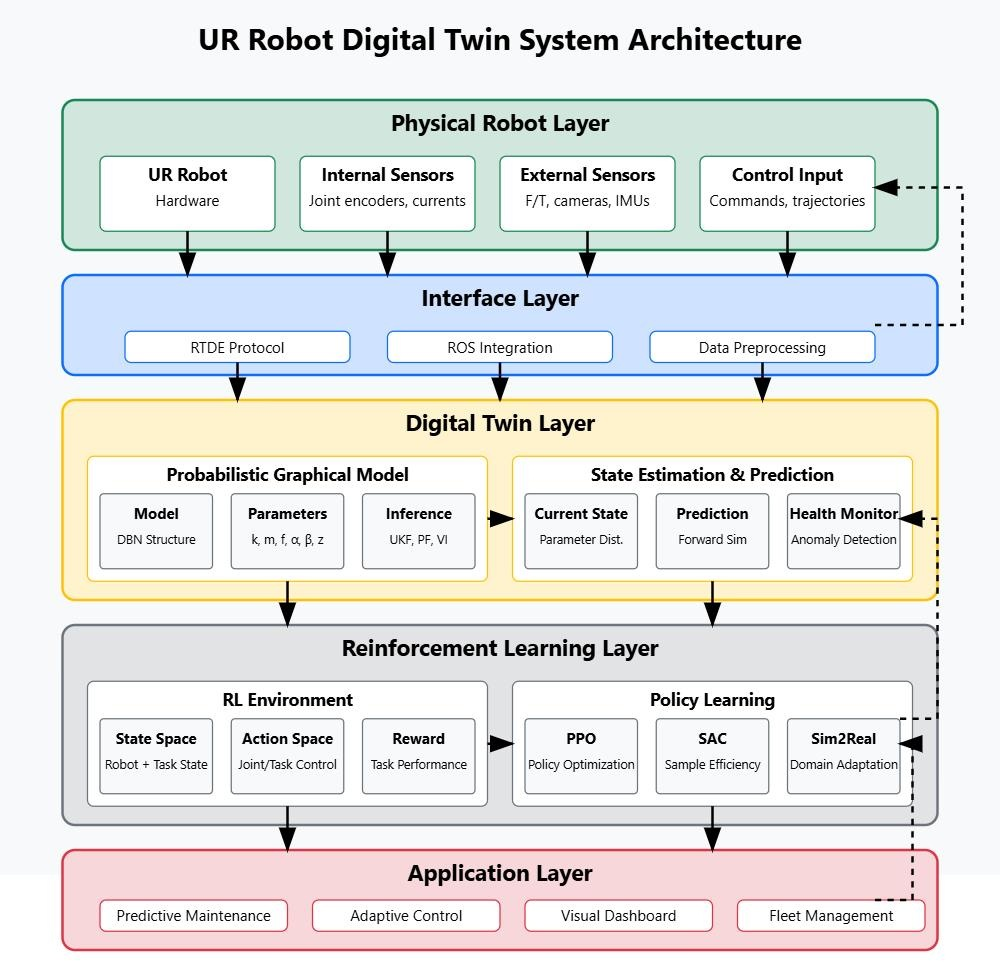

# NVIDIA Physical AI 技術策略評估  
# 第二部分：NVIDIA 平台整合方式及企業自主開發分析   NVIDIA-Based Industrial AI Robotics & Simulation Architecture  

  

# 一、Solution Overview｜解決方案總覽

  

本方案的核心目標，是利用 NVIDIA 的 Physical AI 技術生態系，建立一套適用於工業設備的 AI Robotics 與 Simulation 平台。

整體架構並非單純導入 NVIDIA Isaac Sim 或 Omniverse，而是將技術分為三個主要層次：

1. **Business Workflow Layer：** 負責企業業務規則、設備操作流程及工作調度。
2. **AI Robotics & Simulation Layer：** 利用 NVIDIA Isaac Sim、Omniverse 及其他 Robotics Framework，提供模擬及 AI 訓練能力。
3. **Self-designed Application Layer：** 建立企業專屬的設備模型、工作流程模型及 Scheduler，整合 NVIDIA 平台與企業既有系統。

整體設計原則：

**NVIDIA 提供技術平台，企業掌握應用邏輯與系統架構。**

如此可以利用 NVIDIA 的技術優勢，同時保留企業自身的技術自主權及未來平台轉換彈性。

# 二、Overall Architecture｜整體系統架構

## 2.1 Business Workflow Layer

### Goal：企業業務目標

系統的最上層由企業實際業務需求驅動。

以半導體設備 EFEM 為例，系統需要處理：

- Recipe Routing
- Lot Priority
- Alarm Recovery
- SECS/GEM
- Equipment State
- Dispatch Rule

這些都是工業設備實際運作時必須遵守的業務規則。

### Workflow Runtime

Workflow Runtime 負責定義及執行業務流程規則。

例如：

- Recipe Routing：依據 Recipe 決定設備操作路徑。
- Lot Priority：依據 Lot 優先順序安排工作。
- Alarm Recovery：設備發生異常後的復原流程。
- SECS/GEM：與上層工廠系統交換設備資訊。
- Equipment State：管理設備目前狀態。
- Dispatch Rule：決定工作派送規則。

這一層主要處理已知的業務規則及設備操作邏輯。

### 顧問評估

Workflow Runtime 不應與 AI 模型混為一談。

已經明確定義的設備操作規則，應由傳統 Workflow 或 Rule Engine 執行，而不是全部交給 AI 判斷。

這樣可以維持：

- 流程可預測性。
- 決策可追溯性。
- 操作規則一致性。
- 異常處理的可控性。

---

## 2.2 Workflow Engine

Workflow Engine 是整個解決方案的重要核心。

其主要功能是：

**當系統已經具有明確的業務規則時，負責決定系統應該如何執行。**

例如：

- 已知 Recipe 條件。
- 已知設備狀態。
- 已知 Lot Priority。
- 已知 Alarm Recovery 流程。

Workflow Engine 根據這些資訊執行既定流程。

它與上層 Workflow Runtime 之間具有流程及規則的傳遞關係，並透過 Omniverse OmniGraph 與模擬環境整合。

### 技術定位

Workflow Engine 應作為業務邏輯與底層模擬環境之間的中介層。

其重要價值是讓企業可以自行維護業務流程，而不必將所有流程邏輯寫入 NVIDIA 的模擬工具或 AI 模型。

---

## 2.3 Rule Engine 與 RL / AI Agent

原始架構將決策方式分成兩種。

### A. Rule Engine

適用於已知、明確且可定義的規則。

例如：

IF PM1 Busy

THEN Use PM2

也就是當 PM1 忙碌時，依據既定規則選擇 PM2。

優點：

- 行為可預測。
- 規則容易追蹤。
- 容易進行驗證。
- 不需要額外 AI 訓練。

### B. RL / AI Agent

適用於需要根據環境狀態自主判斷的情境。

例如：

- 多個 PM 同時可用時，如何選擇？
- 多台 Robot 如何分配工作？
- 多台 AMR 如何協調移動？
- 當設備狀態不斷變化時，如何重新安排任務？

RL / AI Agent 的目標，是根據目前環境及任務狀態，自行決定下一個操作目標。

### 核心架構思想：Rule-Based + AI-Based Hybrid Decision

不是所有決策都需要 AI。

建議依據問題性質選擇適當的決策機制：

| 問題類型 | 建議技術 |
|---|---|
| 已知固定規則 | Rule Engine |
| 明確業務流程 | Workflow Engine |
| 複雜動態決策 | RL / AI Agent |
| 多設備協調 | Scheduler + AI |
| 設備物理行為 | Simulation |
| 真實設備控制 | Controller |

### 顧問評估

這種混合式架構比完全依賴 AI Agent 更適合工業環境。

因為工業設備不僅需要最佳化，也需要穩定、可預測及可追溯。

不過，AI Agent 的決策仍需要受到設備安全限制及業務規則約束，不能直接取得不受限制的設備控制權。

---

# 三、NVIDIA Technology Integration｜NVIDIA 技術整合

## 3.1 Omniverse OmniGraph

Omniverse OmniGraph 在本架構中扮演 Simulation Workflow 的整合角色。

原圖列出 Isaac Sim 中的三種圖形化機制：

- Action Graph
- Behavior Graph
- OmniGraph

主要目的是將不同的模擬行為、事件及操作邏輯串接起來。

### 技術應用

例如 EFEM Simulation：

1. Robot 接收搬運任務。
2. Load Port 提供 Wafer。
3. Robot 執行取放動作。
4. Aligner 執行定位。
5. Wafer 移交至 PM。

透過圖形化流程，可以將各個設備行為串接成完整的模擬流程。

### 顧問評估

OmniGraph 適合用於模擬環境中的行為及事件整合。

但企業應避免將所有業務規則都直接綁定在 OmniGraph 中。

建議：

- 業務規則保留在企業 Workflow Engine。
- 模擬行為交由 OmniGraph 執行。
- AI 決策透過獨立介面整合。
- 設備狀態透過標準化資料介面交換。

這樣可以降低平台依賴。

---

## 3.2 World Model

原圖中的 World Model 包含兩個主要部分：

- Real EFEM
- Isaac Sim（Robot Simulation）

其目標是建立真實設備與虛擬設備之間的對應關係。

### Real EFEM

代表實際的 EFEM 設備及其物理行為。

包含：

- Robot。
- Load Port。
- Aligner。
- PM。
- 實際設備狀態。

### Isaac Sim

代表虛擬設備環境。

透過 Isaac Sim 建立 Robot 及設備的模擬環境，供 Workflow Engine 與 AI Agent 使用。

### 技術目的

讓系統能夠在虛擬環境中測試操作流程，並利用真實設備的資訊改善模擬模型。

### 顧問評估

Real EFEM 與 Isaac Sim 之間必須建立清楚的資料交換及同步機制。

例如：

- Robot Position。
- Equipment State。
- Sensor Data。
- Operation Result。
- Alarm Information。

需要特別注意，World Model 並不只是 3D 畫面與真實設備的外觀一致。

真正重要的是物理行為、設備狀態及操作結果的一致性。

---

## 3.3 Isaac Lab — Reinforcement Learning

原圖提出的 AI 問題是：

「Robot 手臂怎麼移動最有效率？多台 AMR 如何避障？」

這些問題具有動態性及複雜性。

例如：

- 多台 Robot 同時執行任務。
- 多台 AMR 同時移動。
- 設備狀態不斷變化。
- 多個任務之間存在資源競爭。

這類問題可能難以單純透過固定 Rule Engine 解決。

因此可以利用 Isaac Lab 進行 Reinforcement Learning，訓練 AI Agent 學習適當的決策策略。

### 顧問評估

RL 適合用於複雜動態決策，但不應直接假設 RL 可以取代傳統 Scheduler。

尤其在多設備協調問題中，仍需要考慮：

- Collision Avoidance。
- Deadlock Prevention。
- Resource Allocation。
- Priority Management。
- Safety Constraints。

建議先建立傳統 Scheduler，再評估 AI 是否能改善特定決策問題。

---

# 四、Self-designed Layer｜企業自主開發層

這是整張架構圖中，我認為最重要的設計。

原圖提出：

**Self-designed Simulation = NVIDIA Platform + Self-designed Plugin**

也就是利用 NVIDIA 提供的底層技術平台，再透過企業自行開發的 Plugin，建立專屬的設備模擬系統。

### 4.1 EFEM Model

建立企業自己的 EFEM 設備模型。

內容包括：

- Load Port。
- Robot。
- Aligner。
- PM。
- Wafer Handling。

不應只建立外觀模型，也需要建立設備的操作行為及相關限制。

### 4.2 Robot Model

建立 Robot 的專屬模型。

包括：

- Kinematics。
- Motion Planning。
- Robot Position。
- Movement Constraints。
- Robot Operation。

### 4.3 Workflow Model

將企業既有設備操作流程轉換成可執行的模擬流程。

例如：

- Wafer Transfer。
- Recipe Routing。
- Equipment Dispatch。
- Alarm Recovery。

### 4.4 Scheduler

建立企業自主的工作排程系統。

例如：

- PM 選擇。
- Robot 工作分配。
- Wafer 搬運順序。
- AMR 任務派送。
- 多設備協調。

### 顧問評估

這一層是企業累積長期技術競爭力的重要位置。

NVIDIA 提供通用平台，但真正具有產業價值的，是企業自身的：

- 設備知識。
- 機械模型。
- 操作流程。
- 製程邏輯。
- Scheduler。
- 驗證資料。

因此，企業不應將這些核心資產完全依賴外部平台。

---

# 五、CAD Integration & Automation｜CAD 整合與自動化

原圖提出一個非常實際的問題：

**為什麼要建置自動化 CAD 與 Simulation Pipeline？**

主要原因是 CAD 模型與 Simulation 模型之間，存在大量重複的人工轉換工作。

如果每次 CAD 設計修改，都需要人工重新整理模擬模型，將會增加時間與人力成本。

因此建議建立自動化 Pipeline。

## 5.1 CAD Automation Pipeline

原圖提出的自動化流程：

Git

↓

CAD Release

↓

CAD Pipeline

↓

USD Generate

↓

Simulation Asset

↓

Isaac Sim

### 流程說明

**Git**

管理 CAD 版本及相關工程資料。

**CAD Release**

CAD 設計完成後，產生正式發布版本。

**CAD Pipeline**

自動執行 CAD 資料處理。

**USD Generate**

將 CAD 資料轉換成 USD 格式。

**Simulation Asset**

建立模擬環境所需的資產。

**Isaac Sim**

匯入模擬環境進行 Simulation。

### 技術價值

- 降低人工轉換工作。
- 提升 CAD 與 Simulation 的一致性。
- 建立版本追蹤能力。
- 減少模型更新所需時間。
- 讓 Simulation 可以跟隨 CAD 設計持續更新。

## 5.2 Manual CAD Pipeline

原圖也提出另一種人工處理流程：

SolidWorks

↓

Export

↓

USD Pipeline

↓

Simplify

↓

Physics Metadata

↓

Isaac Sim

這種方式適合初期驗證或自動化流程尚未建置完成的階段。

其中：

**Simplify**

將完整工程 CAD 簡化為適合 Simulation 使用的模型。

**Physics Metadata**

補充模擬所需的物理資訊，例如：

- Collision。
- Mass。
- Friction。
- Joint。
- Physics Properties。

### 重要風險：CAD 模型過於複雜

原圖特別標示：

- 螺絲 × 5000。
- 墊圈 × 5000。
- 倒角。
- 圓角。

這類工程 CAD 的細節可能造成 GPU 負擔。

因此，不建議直接將完整 Engineering CAD 匯入 Simulation。

應該區分：

1. Engineering CAD：供實際工程設計使用。
2. Simulation CAD：供物理模擬使用。

兩者應保持關聯，但不需要完全相同。

### 顧問評估

CAD-to-Simulation Pipeline 是整個解決方案能否規模化的重要關鍵。

如果沒有自動化機制，每次 CAD 變更都需要人工重新處理，Simulation 將難以成為工程團隊日常使用的工具。

---

# 六、AI Robotics Technology Selection｜AI Robotics 技術選型

原圖比較了三個主要技術方向：

1. NVIDIA Isaac Sim。
2. MuJoCo。
3. Gazebo。

## 6.1 NVIDIA Isaac Sim

主要特色：

- Omniverse。
- OpenUSD。
- RTX Camera。
- RTX LiDAR。
- PhysX。

技術定位：

偏向高擬真視覺模擬、機器人模擬及 NVIDIA AI 生態系整合。

適用於需要整合 3D Digital Twin、感測器模擬及 NVIDIA Robotics 技術的應用。

## 6.2 MuJoCo

原圖標示：

Google DeepMind 主推。

主要特色：

- 模擬速度快。
- 接觸模型表現佳。
- RL 訓練效率高。

優點：

- 非常快。
- 接觸模型優秀。
- RL 訓練效率高。

缺點：

- 畫面相對簡單。

原圖將其定位為 AI Native，代表其適合用於 AI 與強化學習研究。

## 6.3 Gazebo

原圖將其定位為 ROS 世界的標準。

主要特色：

- 開源。
- ROS2 整合佳。

優點：

- 開源。
- ROS2 整合最好。

缺點：

- 不夠漂亮。

原圖將其定位為 AI Bridge，適合需要與 ROS2 生態系整合的應用。

### 技術選型比較

| 評估項目 | Isaac Sim | MuJoCo | Gazebo |
|---|---|---|---|
| 主要定位 | 高擬真模擬 | 物理模擬與 RL | ROS 整合 |
| 視覺效果 | 強 | 相對簡單 | 依環境而定 |
| RL 訓練 | 支援 | 適合 | 可整合 |
| OpenUSD | 支援 | 非核心 | 非核心 |
| ROS2 | 可整合 | 可透過整合 | 原生生態優勢 |
| 主要優勢 | NVIDIA 生態系 | 模擬效率 | 開源與 ROS |
| 主要限制 | 硬體及整合成本 | 視覺呈現較弱 | 高擬真視覺整合需額外工作 |

### 顧問評估

不建議只選擇單一 Simulation Framework。

不同工具具有不同的技術優勢。

例如：

- Isaac Sim：用於高擬真 Robot Simulation。
- MuJoCo：用於 RL 與快速物理模擬。
- Gazebo：用於 ROS2 整合及機器人軟體開發。

是否採用多種工具，應依據實際應用場景及維護成本決定。

---

# 七、Industrial Simulation vs AI Robotics

原圖將技術市場分成兩個不同方向。

## 7.1 Industrial Simulation

### 技術目標

傳統工業模擬主要用於設備與產線的工程驗證。

應用包括：

- 離線程式設計（OLP）。
- 機台佈局驗證。
- PLC 測試。
- Robot Reachability。
- Cycle Time 分析。
- Digital Twin。

適用場景：

- 汽車廠。
- 車體焊接。
- 多機器人協作。
- PLC-in-the-loop。

原圖列出的代表產品：

- Siemens Tecnomatix Process Simulate。
- ABB RobotStudio。
- KUKA.Sim。
- FANUC ROBOGUIDE。
- Visual Components。

原圖特別標示兩個限制：

- NOT Platform / Framework。
- License Fee。

這代表原圖對傳統 Industrial Simulation 工具的評估是：它們主要提供特定應用領域的模擬產品，而不是讓企業自由建構各種 AI Robotics 應用的通用開發平台；此外，也需要考量授權成本。

## 7.2 AI Robotics

### 技術目標

AI Robotics 更著重於讓機器人透過資料、模擬及學習，獲得自主決策能力。

主要方向：

- 機器人學習。
- 視覺 AI。
- Reinforcement Learning。
- Sim2Real。

代表技術：

NVIDIA Isaac Sim。

特色：

- Omniverse。
- OpenUSD。
- RTX Camera。
- RTX LiDAR。
- PhysX。

## 7.3 兩種技術的差異

| 比較項目 | Industrial Simulation | AI Robotics |
|---|---|---|
| 核心目的 | 工程驗證 | AI 學習與自主決策 |
| 主要方式 | 預先定義流程及條件 | 模擬、訓練、學習 |
| 典型應用 | OLP、PLC、Cycle Time | RL、Vision AI、Sim2Real |
| 決策方式 | 傳統規則與控制 | AI + Rule |
| 主要價值 | 降低工程驗證成本 | 提升機器人自主能力 |

### 顧問評估

兩者不是互相取代的關係。

Industrial Simulation 解決的是工程設計及設備驗證問題。

AI Robotics 解決的是機器人學習及自主決策問題。

企業應先確認目標，再選擇適合的技術，而不是將所有 Industrial Simulation 都升級成 AI Robotics。

---

# 八、Visual Components 與 Siemens Tecnomatix

原圖另外列出兩種可作為工業 AI 整合橋接的方向。

## 8.1 Visual Components

原圖提出的近期整合方式：

- Python Script。
- REST API。
- OPC-UA。
- MES Integration。

可能的架構：

LLM

↓

Workflow Engine

↓

Visual Components

並以「工業 AI Bridge」作為定位。

### 技術意義

利用既有 Industrial Simulation 軟體，再透過 API、Python 及 OPC-UA 整合 AI 與工業系統。

不需要立即重新建置整套 Simulation Platform。

## 8.2 Siemens Tecnomatix

原圖提出的技術組合：

Microsoft

+

Azure AI

+

Siemens Xcelerator

並透過：

自然語言

↓

PLC Logic

↓

Simulation

↓

Deployment

作為可能的工業 AI 整合流程。

同樣以「工業 AI Bridge」定位。

### 顧問評估

Visual Components 與 Siemens Tecnomatix 可以作為既有工業模擬環境的 AI 整合路徑。

對於已經投資大量工業模擬工具的企業，不一定需要全面替換現有平台。

可以先透過 API、REST、OPC-UA 及 Workflow Engine 建立整合架構。

但實際整合能力、API 可用範圍及授權條件仍需逐項驗證。

---

# 九、建議導入策略

根據上述架構，建議企業分成四個階段導入。

## Phase 1：Industrial Simulation Integration

目標：確認既有設備及模擬環境的整合能力。

工作項目：

- 選擇單一 EFEM。
- 建立設備 CAD。
- 匯入 Isaac Sim。
- 建立基本 Robot Simulation。
- 驗證設備動作及操作流程。

主要成果：

建立可運作的 EFEM Simulation Prototype。

## Phase 2：Self-designed Workflow Engine

目標：建立企業自主的 Workflow Engine 及設備模型。

工作項目：

- EFEM Model。
- Robot Model。
- Workflow Model。
- Scheduler。
- Rule Engine。
- Omniverse OmniGraph Integration。

主要成果：

建立企業自主控制的 Simulation Framework。

## Phase 3：AI Robotics Integration

目標：導入 AI Agent 與 RL。

工作項目：

- Isaac Lab。
- Reinforcement Learning。
- Robot Motion Planning。
- Multi-Robot Coordination。
- AMR Scheduling。
- AI Decision Integration。

主要成果：

建立 AI 輔助決策與自主操作能力。

## Phase 4：CAD Automation & Sim2Real

目標：將 Simulation 與實際工程流程整合。

工作項目：

- CAD Pipeline。
- USD Generate。
- Simulation Asset。
- Physics Metadata。
- Real Equipment Integration。
- Sim-to-Real Validation。

主要成果：

建立可持續更新的 Digital Twin 與 Physical AI 開發流程。

---

# 十、Final Architecture Assessment｜最終架構評估

本方案的核心價值在於將 NVIDIA 的底層技術能力，與企業自身的工業知識及業務邏輯分離。

整體可以歸納為以下架構：

**第一層：Business Logic**

企業定義 Workflow、Rule、Equipment State 及 Dispatch Rule。

**第二層：Decision Engine**

透過 Workflow Engine、Rule Engine 及 RL Agent 處理不同類型的決策問題。

**第三層：Simulation Platform**

透過 NVIDIA Omniverse、Isaac Sim 及相關工具建立模擬環境。

**第四層：Enterprise Application**

企業自主建立 EFEM Model、Robot Model、Workflow Model 及 Scheduler。

**第五層：Real World Integration**

透過真實設備資料及實際操作結果，持續驗證及改善 Simulation。

## 最終顧問結論

本方案不建議將 NVIDIA 定位為完整的工業 AI 應用解決方案，而應將 NVIDIA 定位為 Physical AI 的底層技術平台。

企業應保留自身的 Workflow Engine、Rule Engine、Scheduler 及設備模型，透過 Plugin 與 NVIDIA 平台整合。

如此可以同時取得 NVIDIA 在 GPU、Simulation、3D 視覺及 AI Robotics 的技術優勢，也能保留企業在設備知識、業務流程及系統架構上的自主性。

**最重要的策略不是導入 NVIDIA，而是利用 NVIDIA 建立企業自己的 Physical AI Platform。**

---

*文件性質：初步解決方案架構評估（Preliminary Solution Architecture Assessment）*

*本文件依據第二張架構圖整理。圖中架構屬於規劃及設計構想，不代表所有整合功能已完成實作或通過產品級驗證。*

---

# 諮詢服務報價  

| 等級      | 服務定位         | 費率          |
| ------- | ------------ | ----------- |
| Level 2 | 技術評估         | NT$7,000/hr |
| Level 3 | 專家顧問、策略與專家評估 | NT$9,000/hr |

## 專案報價

| 工作項目                                 | 等級 | 時數     | 費用          |
| ------------------------------------ | -- | ------ | ----------- |
| 技術需求與應用情境分析                          | L2 | 2      | 14,000      |
| NVIDIA 技術整合研究                        | L2 | 4      | 28,000      |
| Isaac Sim、MuJoCo、Gazebo 比較           | L2 | 3      | 21,000      |
| 系統分層及模組架構設計                          | L3 | 6      | 54,000      |
| Workflow、Rule Engine、RL Agent 整合架構設計 | L3 | 4      | 36,000      |
| 原創 Solution Architecture 圖設計與繪製      | L3 | 3      | 27,000      |
| 報告撰寫與品質檢查                            | L2 | 4      | 28,000      |
| **合計**                               |    | **26** | **208,000** |

## 交付成果  

- NVIDIA Physical AI 解決方案架構分析。
- 系統模組及責任邊界評估。
- 技術選型比較。
- Rule Engine、Workflow Engine、RL Agent 架構分析。
- Simulation Framework 技術比較。
- CAD Automation Pipeline 評估。
- NVIDIA 與企業自主開發層的整合建議。
- 企業自主開發架構及導入 Roadmap 建議。

## 服務範圍及限制

本報價包含：

- 技術資料研究及分析。
- 系統架構評估。
- 技術方案比較。
- 技術風險分析。
- 顧問評估報告撰寫。
- 一次整體報告說明及問題討論。

本報價不包含：

- NVIDIA 平台實際建置。
- Software Development。
- Proof of Concept 實作。
- GPU 實機效能測試。
- CAD 模型建置及轉換。
- Real Equipment Integration。
- 客戶端實地設備測試。

## 商務條件

- 上述費用未含營業稅。
- 本報價依據目前提供之技術架構圖及評估範圍制定。
- 如實際研究範圍或交付需求有所增加，應另行確認工時及費用。

---

# Others | 其他資訊  

## ChatGPT 整合圖  

> [!NOTE]  
> 此部分為 AI 分析，僅供參考，不包含於正式顧問服務交付範圍。

  

---

# 著作權聲明

© 2026 潘貞元（Reta Pan） [保留一切權利](https://github.com/retamotome/retamotome/blob/main/LICENSE.md)。

