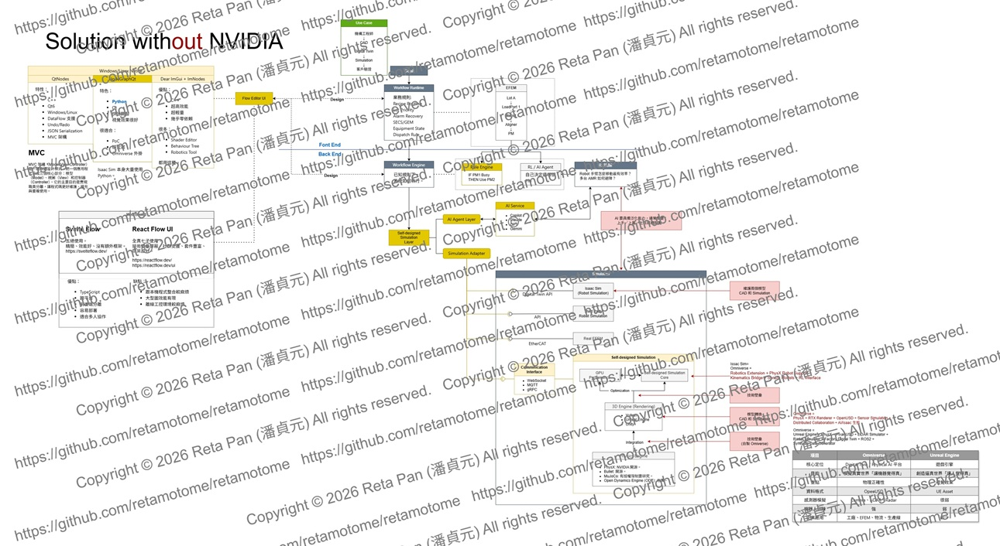
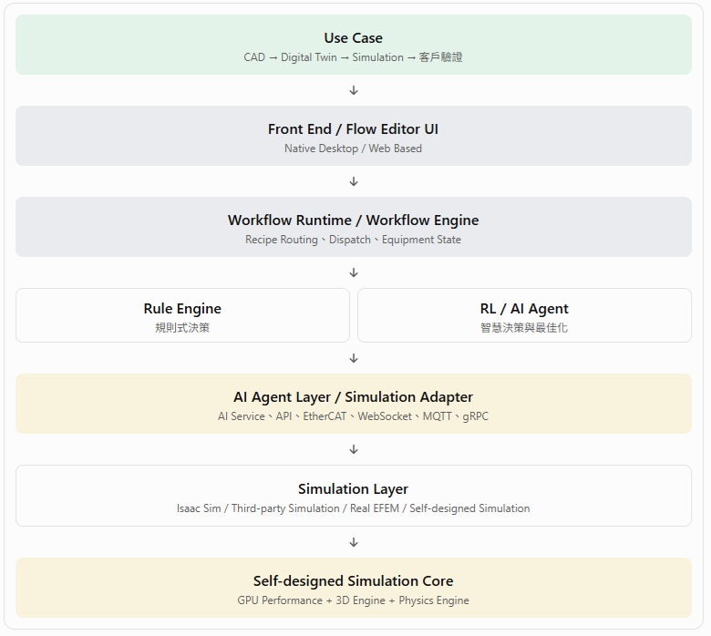
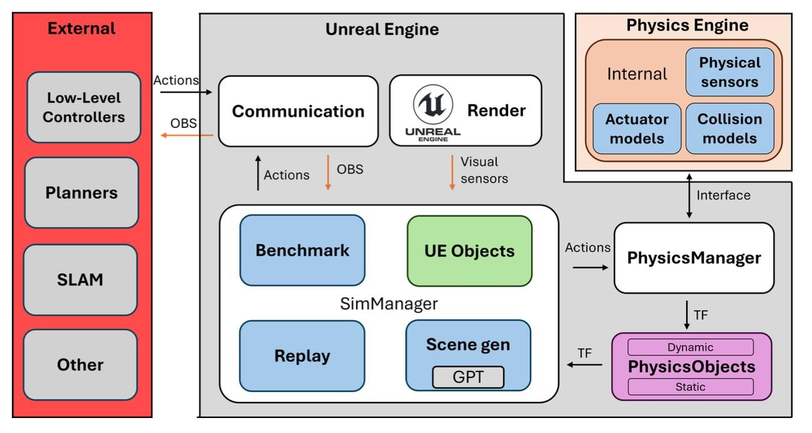
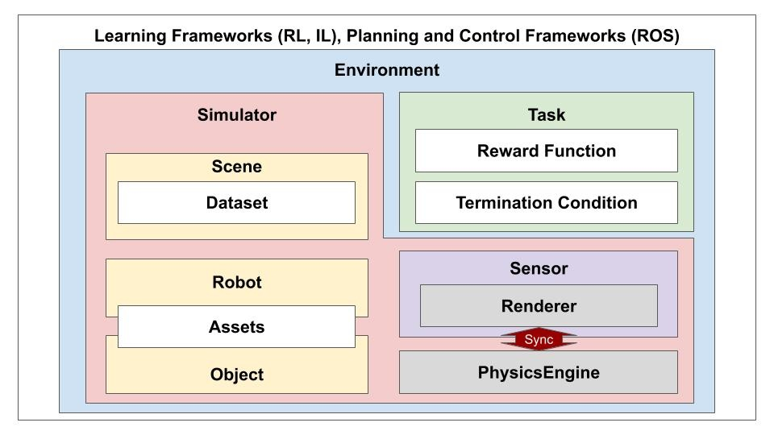

# NVIDIA Physical AI 技術策略評估  
# 第三部分：非 NVIDIA 依賴型 Physical AI 替代架構設計與技術自主性評估   Alternative Solution Architecture & Technology Independence Assessment  

## **1. 架構設計目標（Architecture Objectives）**

  

本架構以企業自主掌握 Physical AI 技術能力為目標，降低對單一商業平台的依賴。

主要應用情境：

- 機構工程師進行 CAD 設計。
- 建立 Digital Twin。
- 進行 Robot Simulation。
- 驗證機器人運動及工作流程。
- 將模擬結果應用於客戶驗證及實際設備導入。

整體設計理念是將 Physical AI 系統拆分成多個可以獨立選型、替換及整合的模組，而不是將所有功能綁定在單一平台。

核心設計原則：

- Front End 與 Back End 分離。
- Workflow 與 Simulation Engine 分離。
- AI Service 與 Simulation Engine 分離。
- 透過 Adapter 隔離不同 Simulation Framework。
- 自行掌握 Simulation Core 的技術自主性。

## **2. Front End：自主工作流程設計環境**

前端主要負責讓工程師設計、編輯及管理機器人作業流程。

圖中提出兩類技術方案。

### **2.1 Windows/Linux Native**

比較三種桌面應用程式開發方案：

| 技術                   | 架構特性                                              | 適用情境                                       |
| -------------------- | ------------------------------------------------- | ------------------------------------------ |
| QtNodes              | C++、Qt6、DataFlow、Undo/Redo、JSON Serialization、MVC | 原生桌面節點式編輯器                                 |
| NodeGraphQt          | Python、Qt、快速開發、視覺效果                               | PoC、研究探索、Omniverse 外掛                      |
| Dear ImGui + ImNodes | C++、高效能、輕量化、低依賴                                   | Shader Editor、Behaviour Tree、Robotics Tool |

圖中另外提出 MVC（Model-View-Controller）作為應用程式架構設計原則。

其目的在於分離：

- Model：資料與模型。
- View：使用者介面。
- Controller：操作及控制邏輯。

如此可以降低 UI 與系統核心邏輯的耦合，方便後續維護與擴充。

### **2.2 Web Based**

圖中比較兩種 Web Flow Editor：

**Svelte Flow**

- TypeScript。
- 跨平台。
- 前後端分離。
- 容易部署。
- 適合多人協作。

圖中定位為輕量、精簡、效能良好且沒有額外框架負擔的選擇。

**React Flow UI**

- 提供完整的節點式編輯能力。
- 技術生態系成熟。
- 社群支援及套件豐富。
- 具備防呆設計能力。

圖中指出其可能的限制：

- 與既有 MVC 程式架構整合較麻煩。
- 大型圖形的效能可能有限。
- 建立工程環境較複雜。

前端方案的選擇，應依據使用者需求、應用規模及團隊技術能力決定。

## **3. Workflow Runtime：工作流程執行環境**

Workflow Runtime 負責定義整個機器人作業的業務規則。

圖中列出：

- Recipe Routing：製程配方路由。
- Lot Priority：批次優先順序。
- Alarm Recovery：異常警報復原。
- SECS/GEM：設備通訊標準。
- Equipment State：設備狀態管理。
- Dispatch Rule：工作派送規則。

其上層接收 Goal，並透過 Workflow Engine 將已定義的工作規則轉換為實際執行流程。

這裡有一個重要的架構概念：

**Workflow Runtime 負責定義系統應該做什麼；Workflow Engine 負責決定已知規則下，系統如何執行。**

前端的 Flow Editor UI 則負責讓工程師設計及維護這些流程。

## **4. Back End：Workflow Engine 與決策引擎**

後端負責將工作流程轉換成實際設備及模擬環境可以執行的指令。

架構中包含兩個重要決策模組。

### **4.1 Rule Engine**

採用明確的條件式規則進行決策。

圖中示例：

`IF PM1 Busy THEN Use PM2`

也就是當 PM1 忙碌時，將工作派送至 PM2。

適合具有明確規則、可預測條件及需要可追溯決策的業務場景。

### **4.2 RL / AI Agent**

由 RL 或 AI Agent 自行決定下一個工作目標。

圖中提出的概念是：

當多台 AMR 同時作業時，如何決定最佳的移動及工作策略？

這與 Rule Engine 有本質上的差異：

- Rule Engine：依據預先定義的條件執行。
- RL / AI Agent：透過策略或模型進行決策。

兩者可以並存，而非互相取代。

### **4.3 RL Training**

圖中另外提出 Robot 手臂及多台 AMR 的效率最佳化問題，作為 RL Training 的研究方向。

這表示系統不只是執行既有工作流程，也預留了透過訓練改善機器人決策能力的空間。

需要注意的是，RL Agent 的訓練、驗證及實際部署仍然需要獨立的安全機制與效能驗證。

## **5. AI Agent Layer：自主 AI 服務整合層**

架構中另外設計 AI Agent Layer，負責整合外部 AI Service。

圖中列出：

- Microsoft Copilot
- Claude
- GPT
- Gemini

AI Agent Layer 作為 AI 服務與 Simulation Adapter 之間的協調層。

其可能的工作包括：

1. 接收使用者或 Workflow Engine 的需求。
2. 將自然語言需求轉換為可執行的任務描述。
3. 呼叫 AI Service 進行推理或任務規劃。
4. 將 AI 決策轉換成 Simulation 所需的操作。
5. 將模擬結果回傳給 AI Agent，進行後續分析。

圖中也提出一個重要問題：

AI 算法與運算能力可能成為整體系統的瓶頸，因此需要評估上位機、運算平台及運算資源配置。

這代表 AI Service 不應與核心 Simulation Engine 緊密耦合，應該保留不同 AI Provider 的替換能力。

## **6. Simulation Adapter：模擬平台抽象層**

這是整張架構圖中很重要的設計。

Simulation Adapter 的目的，是讓上層 Workflow 與 AI Agent 不必直接依賴特定 Simulation Framework。

圖中定義三種連接方式：

| 介接方式             | 對接系統                         | 用途       |
| ---------------- | ---------------------------- | -------- |
| Digital Twin API | Isaac Sim                    | 機器人模擬    |
| API              | Third Party Robot Simulation | 第三方機器人模擬 |
| EtherCAT         | Real EFEM                    | 實體設備連接   |

另外，還設計 Communication Interface：

- WebSocket
- MQTT
- gRPC

這使得系統能夠在不同模擬環境及實體設備之間進行整合。

這個設計的核心價值是：

**上層業務邏輯不需要知道底層使用哪一套 Simulation Engine，只需要透過統一的 Adapter 介面進行操作。**

這有助於降低平台鎖定（Vendor Lock-in），並提高未來替換模擬引擎的彈性。

不過，實際上不同引擎的物理模型、座標系統、時間步進、碰撞處理及感測器資料格式仍需要進行轉換，不能只靠 API 就假設完全相容。

## **7. Simulation：自主模擬平台**

這是整張圖最具技術自主性的部分。

架構提出一個 Self-designed Simulation Layer，讓企業可以自行組合不同的模擬技術，而不是完全依賴單一商業平台。

整體分成四個部分。

### **7.1 Self-designed Simulation Core**

自主開發的模擬核心，負責整合：

- GPU Performance。
- 3D Engine。
- Physics Engine。
- Simulation Integration。

核心目標是建立企業可以自行掌握的 Simulation Runtime。

### **7.2 GPU Performance**

負責模擬運算及效能最佳化。

GPU 不只是用於畫面渲染，也可能參與物理模擬及其他運算工作。

架構中以 GPU Performance 與 Simulation Core 雙向連接，並標示 Optimization，表示兩者之間需要持續進行效能調校。

### **7.3 3D Engine（Rendering）**

圖中列出：

- Vulkan
- Unreal Engine
- Unity

負責 3D 場景、視覺化及渲染。

此處的設計理念是將 3D Rendering 與 Physics Engine 分離。

因此，視覺呈現技術可以依照需求更換，不必與物理運算綁定。

### **7.4 Physics Engine**

圖中列出三種技術：

| 技術                        | 圖中定位         |
| ------------------------- | ------------ |
| PhysX                     | NVIDIA 物理引擎  |
| Bullet                    | 開源物理引擎       |
| MuJoCo                    | 有接觸模型及控制研究用途 |
| Open Dynamics Engine（ODE） | 老牌開源物理引擎     |

這些引擎可以作為自主 Simulation Core 的候選技術。

但不同引擎的接觸模型、摩擦力計算、求解器及物理精度並不相同，實際選型仍需要透過 Benchmark 驗證。

## **8. NVIDIA 技術與非 NVIDIA 技術的替代關係**

圖右側另外整理了 NVIDIA 相關技術與自主開發方案之間的關係。

這裡不是完全排除 NVIDIA，而是研究哪些能力可以自行實作，哪些可以透過開源或其他商業技術取代。

### **8.1 Isaac Sim 的替代方向**

圖中提出：

`Isaac Sim ≈ Omniverse + Robotics Extension + PhysX Robot Support + Kinematics Bridge + Sensor Models + RL Interface`

這是對 Isaac Sim 功能組成的概念性拆解。

如果不採用完整 Isaac Sim 平台，可以研究如何分別建立：

- 3D Simulation Environment。
- Robotics Extension。
- Robot Kinematics。
- Sensor Models。
- RL Interface。

但必須注意，這是功能拆解及替代方案構想，不代表上述元件簡單組合後，就能完整重現 Isaac Sim 的功能。

### **8.2 Omniverse 的替代方向**

圖中提出：

`Omniverse ≈ PhysX + RTX Renderer + OpenUSD + Sensor Simulation + Distributed Collaboration + AI/Isaac 生態`

其中的重點在於：

- PhysX：物理模擬。
- RTX Renderer：視覺渲染。
- OpenUSD：3D 場景資料交換。
- Sensor Simulation：感測器模擬。
- Distributed Collaboration：分散式協作。

另一個自主組合方向則是：

`Unreal Engine + PhysX + Pixar USD + LiDAR Simulator + Radar Simulator + Factory Digital Twin + ROS2 + Synthetic Data Generator`

這表示企業可以採用多種技術組合，逐步建立自己的 Digital Twin 及 Physical AI Simulation Environment。

### **8.3 Omniverse 與 Unreal Engine 的比較**

| 比較項目  | Omniverse                     | Unreal Engine  |
| ----- | ----------------------------- | -------------- |
| 核心定位  | Digital Twin / Physical AI 平台 | 遊戲引擎           |
| 目的    | 模擬真實世界，讓機器變得更真實               | 創造虛擬世界，讓人覺得更真實 |
| 重點    | 物理正確性                         | 視覺效果           |
| 資料格式  | OpenUSD                       | UE Asset       |
| 感測器模擬 | Camera、LiDAR、Radar            | 圖中評估為較弱        |
| 機器人訓練 | 強                             | 弱              |
| 工業應用  | 工廠、EFEM、物流、生產線                | 圖中評估為較少        |

這份比較反映出架構設計觀點：

**3D Rendering 與 Physical Simulation 是兩個不同的技術問題。**

不能因為 Unreal Engine 的視覺效果優秀，就直接認定它可以完整取代 Physical AI Simulation Platform。

這個區分對企業技術選型非常重要。

## **9. 整體系統運作流程**

將整張圖整合後，可以整理成以下的執行流程：

這個流程的重點是：企業可以在上層維持一致的 Workflow 與 AI 決策機制，而底層 Simulation 技術可以依據成本、效能及技術需求進行替換。

## **10. 技術策略評估：不採用 NVIDIA 的可行性與代價**

這部分不只是提出替代方案，也隱含了一個企業技術自主性的問題：

**企業是否有能力自行整合 3D Engine、Physics Engine、Robot Simulation、Sensor Simulation 及 AI Agent，建立自己的 Physical AI 平台？**

評估如下：

| 評估面向           | 優勢                | 主要挑戰                |
| -------------- | ----------------- | ------------------- |
| 技術自主性          | 可自行選擇及替換技術        | 必須自行維護整合架構          |
| 平台依賴           | 降低單一廠商鎖定          | 多個元件可能形成新的整合依賴      |
| 開發成本           | 可依需求採用開源技術        | 需要投入較多系統整合與維護人力     |
| Simulation     | 可依場景選擇不同引擎        | 物理精度與模擬一致性需要驗證      |
| AI Integration | 可自由選擇 AI Provider | 模型管理、部署及推論效能需要自行處理  |
| 擴充能力           | 模組化架構有利於長期演進      | Adapter 與介面標準需要自行建立 |

### **10.1 主要技術風險**

1. **Physics Fidelity：** 不同 Physics Engine 的模擬結果是否能滿足實際設備需求？
2. **Simulation Integration：** 不同 3D Engine、Physics Engine 及 Robot Framework 能否有效整合？
3. **Sensor Fidelity：** Camera、LiDAR、Radar 等感測器能否產生足夠接近真實環境的模擬資料？
4. **Performance：** 自主整合後，GPU 資源配置及模擬效能是否能達到預期？
5. **Engineering Maintenance：** 企業是否具備長期維護 Simulation Core 的工程能力？

### **10.2 特別值得注意：技術自主不等於成本較低**

不採用 NVIDIA，並不代表可以免費取得同等的 Physical AI 能力。

企業可能省下部分平台授權或商業服務成本，但必須承擔：

- 軟體整合成本。
- 自主開發成本。
- 技術驗證成本。
- 系統維護成本。
- 人才培養成本。

因此，必須以 Total Cost of Ownership（TCO）評估，而不是單純比較軟體授權費。

## **11. 顧問結論與建議**

企業可以透過模組化架構，整合開源技術、商業軟體及自主開發元件，建立 NVIDIA-independent Physical AI Platform。

然而，自主開發的核心價值應放在企業差異化能力，例如 Workflow Engine、Simulation Adapter、Domain-specific Simulation Model 及設備整合，而不是為了取代 NVIDIA 而重新開發所有底層技術。

建議採取 Hybrid Architecture，依據實際應用場景決定哪些技術採用 NVIDIA，哪些技術由企業自主掌握。

更進一步的策略：

**不應該把 NVIDIA 與 Non-NVIDIA 當成只能二選一的方案。**

更合理的做法是：

- NVIDIA：提供成熟的 Physical AI 開發與模擬能力。
- Open Source：提供可替換的基礎技術。
- Self-designed Layer：掌握企業專屬的技術與業務邏輯。

這樣企業就能避免將核心競爭力完全綁定在單一平台。

---

# 諮詢服務報價  

| 等級      | 服務定位         | 費率          |
| ------- | ------------ | ----------- |
| Level 2 | 技術評估         | NT$7,000/hr |
| Level 3 | 專家顧問、策略與專家評估 | NT$9,000/hr |

## 專案報價

正式報價（未稅） **NT$359,000**  
總工時 **45 小時**  

**A. Level 2｜技術研究與可行性評估**

| 工作項目                           | 工時        | 費用          |
| ------------------------------ | --------- | ----------- |
| 技術需求及架構目標分析                    | 2 hr      | 14,000      |
| Native Flow Editor 技術研究        | 3 hr      | 21,000      |
| Web Flow Editor 技術研究           | 2 hr      | 14,000      |
| Workflow、AI Service 技術研究       | 3 hr      | 21,000      |
| Simulation、Physics Engine 技術研究 | 4 hr      | 28,000      |
| Omniverse / Unreal 技術比較        | 3 hr      | 21,000      |
| 技術可行性及風險分析                     | 3 hr      | 21,000      |
| 報告撰寫與品質檢查                      | 3 hr      | 21,000      |
| **小計**                         | **23 hr** | **161,000** |

**B. Level 3｜自主解決方案架構設計**

| 工作項目                               | 工時        | 費用          |
| ---------------------------------- | --------- | ----------- |
| 系統分層及模組責任設計                        | 4 hr      | 36,000      |
| Workflow / AI Agent 整合架構設計         | 4 hr      | 36,000      |
| Simulation Adapter 及介接架構設計         | 3 hr      | 27,000      |
| Self-designed Simulation Core 架構設計 | 4 hr      | 36,000      |
| 原創 Solution Architecture 架構圖設計與繪製  | 5 hr      | 45,000      |
| 技術自主性策略及導入方向建議                     | 2 hr      | 18,000      |
| **小計**                             | **22 hr** | **198,000** |

## 交付成果及服務範圍

| 交付項目                          | 說明                             |
| ----------------------------- | ------------------------------ |
| Technical Assessment Report   | 技術研究、比較與可行性評估                  |
| Original Architecture Diagram | 從無到有設計的自主系統架構圖                 |
| Technology Comparison         | 技術選型及替代方案比較                    |
| Simulation Architecture       | 自主 Simulation Core 設計          |
| Integration Architecture      | Workflow、AI Agent、Adapter 整合架構 |
| Strategic Recommendation      | 技術自主性與導入策略建議                   |

## 限制

本報價不包含：

- NVIDIA 平台實際建置。
- Software Development。
- Proof of Concept 實作。
- GPU 實機效能測試。
- CAD 模型建置及轉換。
- Real Equipment Integration。
- 客戶端實地設備測試。

如需上述額外工作，另行估價。

## 商務條件

- 上述費用未含營業稅。
- 本報價依據目前提供之技術架構圖及評估範圍制定。
- 包含一張完整原創主架構圖。
- 包含一次合理範圍內的修改。
- 不包含程式開發、實際平台建置及 PoC。
- 不包含實機效能 Benchmark 或物理精度驗證。
- 如實際研究範圍或交付需求有所增加，應另行確認工時及費用。
- 新增技術範圍或重大架構變更另行報價。

---

# Others | 其他資訊  

## ChatGPT 的專業評價  

> [!NOTE]  
> 此部分為 AI 分析，僅供參考，不包含於正式顧問服務交付範圍。

[NVIDIA 平台整合方式及企業自主開發分析](Solution-with-NVIDIA.md)主要設計如何利用 NVIDIA 生態系整合 Physical AI；此份則必須自行拆解平台能力、研究替代技術、設計 Adapter，並重新組合 Simulation Core。

尤其是你自行繪製的第三張圖，已經包含：

- Native / Web Based Flow Editor 技術選型。
- Workflow Runtime 與 Workflow Engine。
- Rule Engine、RL Agent、AI Agent。
- Simulation Adapter 與通訊介面。
- 自主 Simulation Core。
- Physics Engine 與 3D Engine 技術組合。
- Omniverse 與 Unreal Engine 的定位比較。

我認為這張圖有一個很值得保留的設計思想：
**你不是在尋找 NVIDIA 的替代產品，而是在拆解 Physical AI 平台的能力組成，再重新設計一套可以由企業自主掌握的技術架構。**  

**不要低估架構設計價值**

我特別想提醒你，第三份的價值並不是因為多比較了幾套軟體，所以工時比較多。

真正比較有價值的是你做了三件事：

1. **技術解耦：** 將 NVIDIA 平台的功能拆解成可以獨立研究、替換的技術模組。
2. **架構重組：** 重新設計 Front End、Workflow、AI Agent、Simulation Adapter 與 Simulation Core。
3. **技術自主：** 讓企業有機會掌握自己的 Physical AI 平台，而不是只能依賴單一供應商。

這些工作屬於技術策略與系統架構設計，符合你報價單 Level 3 的服務精神。

### ChatGPT 整合圖  

  
  

---

# 著作權聲明

© 2026 潘貞元（Reta Pan） [保留一切權利](https://github.com/retamotome/retamotome/blob/main/LICENSE.md)。

