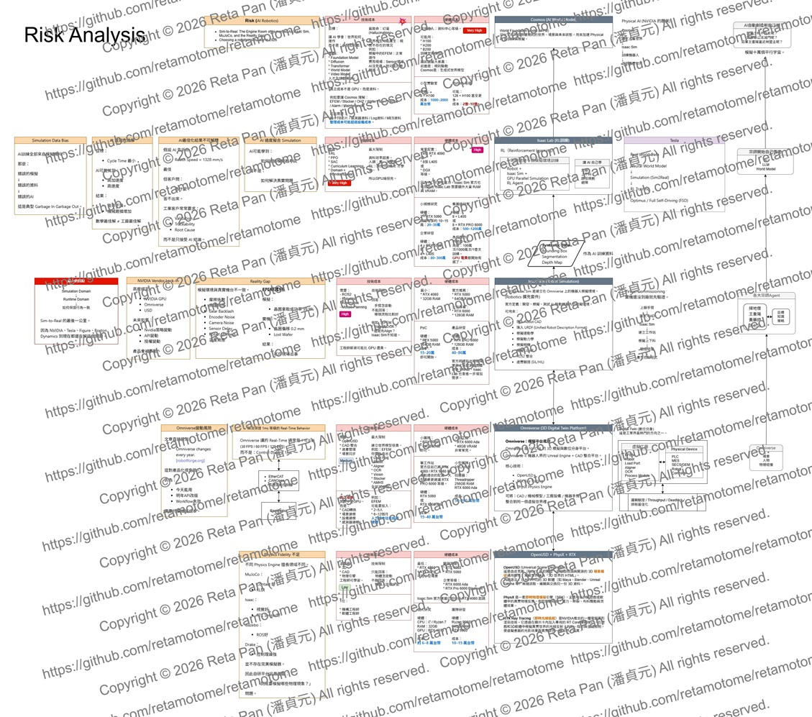
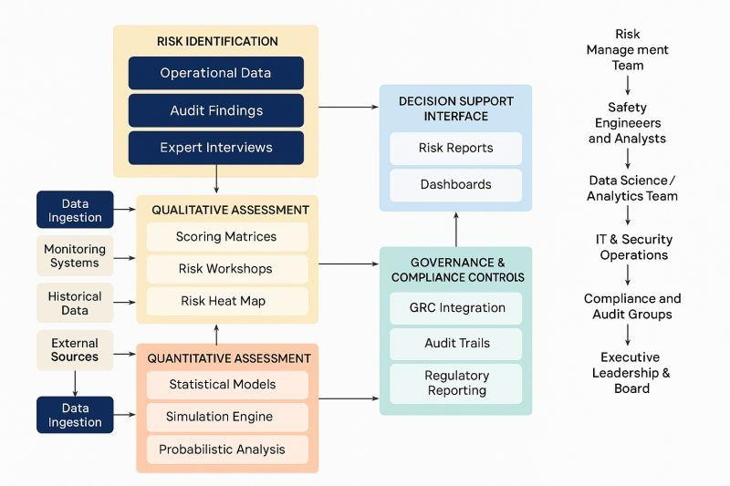

# NVIDIA Physical AI 技術策略評估報告  
# 第一部分：技術導入風險分析  <br>NVIDIA Physical AI Technology Strategy & Risk Assessment    

**報告定位：技術顧問評估（Technology Consulting Assessment）**

**評估範圍：** NVIDIA Physical AI 技術架構、Simulation、Digital Twin、Reinforcement Learning、World Model、Sim-to-Real，以及企業導入風險。

---

# 一、Executive Summary｜執行摘要

  

NVIDIA Physical AI 的核心方向，是透過 AI、物理模擬、數位分身及強化學習，讓 AI 不只理解數位世界中的資訊，也能理解真實物理世界中的物體、環境、動態與因果關係。

其技術架構可以分成五個主要層次：

1. **World Foundation Model：** 透過 Cosmos 建立對物理世界的理解。
2. **Robot Simulation：** 透過 Isaac Sim 建立機器人與設備的虛擬模擬環境。
3. **Reinforcement Learning：** 透過 Isaac Lab 訓練 AI Agent 的行為與控制策略。
4. **Digital Twin：** 透過 Omniverse 建立設備、產線及工廠的數位分身。
5. **Physical AI Deployment：** 將訓練完成的 AI 模型部署至真實設備，並透過 Real World Data 持續改善。

然而，Physical AI 的主要挑戰並非單純的 GPU 運算能力，而是：

- Simulation 與 Real World 的物理差異。
- 訓練資料的品質與代表性。
- Physics Engine 的模擬精確度。
- 即時控制與模擬效能的差異。
- 整合現有工業設備及控制系統的複雜度。
- AI 模型在真實環境中的可靠性與可追溯性。

**顧問初步判斷：**

NVIDIA Physical AI 的技術方向具有發展潛力，但企業不應直接將 NVIDIA 的技術展示能力視為實際工業產品的成熟度。

真正的技術驗證重點，應該放在特定設備、特定製程及特定操作條件下，能否達成可量測、可重現及可驗證的結果。

---

# 二、Physical AI 技術架構分析

## 2.1 Cosmos — World Foundation Model

### 技術定位

Cosmos 是 NVIDIA 用於 Physical AI 的生成式世界模型（World Foundation Model）。

其主要技術方向包括：

- Foundation Model
- Diffusion
- Transformer
- World Model
- Video Model

與傳統規則式模擬不同，World Model 的目標是讓 AI 學習物理世界的運作方式，理解場景、物體及環境的變化，並生成可能發生的未來情境。

### 技術應用

以半導體設備為例，未來可以利用設備資料建立訓練環境，讓 AI 理解：

- EFEM（Equipment Front End Module）
- Stocker
- OHT（Overhead Hoist Transport）
- Wafer Flow
- Recipe
- Alarm
- Maintenance

透過大量模擬與生成資料，訓練 AI 理解設備運作與異常情境。

### 技術風險

**第一：領域資料不足。**

通用世界模型不代表已經理解特定工業設備的物理特性及製程邏輯。

如果缺乏真實設備資料，AI 可能無法正確理解設備的特殊行為。

**第二：Synthetic Data 的代表性。**

生成式資料不一定符合真實設備的物理規律。

如果生成資料本身存在偏差，後續模型訓練可能放大錯誤。

**第三：資料取得成本。**

真正的成本可能不是 GPU，而是取得及整理以下資料：

- 設備感測器資料
- BMS 資料
- Log 資料
- MES 資料
- Alarm / Maintenance 資料

### 顧問評估

Cosmos 的企業導入價值，取決於能否取得足夠的產業領域資料，以及能否驗證生成資料與真實設備行為的一致性。

不應直接假設通用 World Model 可以取代設備專屬的模擬模型。

---

## 2.2 Omniverse — 3D Digital Twin Platform

### 技術定位

Omniverse 是 NVIDIA 的 3D 模擬與數位分身平台。

主要核心技術包括：

- OpenUSD
- CAD Integration
- RTX Ray Tracing
- PhysX Physics Engine
- Workflow Integration

Omniverse 可以整合不同來源的 3D 模型、設備 CAD、機械結構及工廠場景，建立統一的虛擬環境。

### 技術應用

以 EFEM 為例，可以將以下元件整合至同一個虛擬場景：

- Load Port
- Robot
- Aligner
- OCR
- Stocker
- AMHS
- Process Module
- Controller

透過 Digital Twin，企業可以在實際設備建置之前，先進行虛擬場景驗證。

例如：

- 設備空間配置。
- Robot 動作路徑。
- 設備間的協調與互動。
- 產線流程。
- Throughput。
- Deadlock。

### 重要技術限制：Real-Time 的定義

Omniverse 所強調的 Real-Time，通常是指場景的即時互動及視覺呈現。

例如：

- 30 FPS
- 60 FPS
- 120 FPS

但這不代表可以直接滿足工業設備的即時控制需求。

例如：

**Control Loop = 1ms**

這是完全不同層次的技術要求。

因此，Omniverse 不應直接被視為 PLC、Motion Controller 或即時控制系統的替代品。

### 技術風險

1. CAD 模型與實際設備的差異。
2. 大型 3D 場景的 GPU / VRAM 需求。
3. 不同軟體與設備模型的整合成本。
4. OpenUSD、API 及軟體版本變更。
5. 長期維護及場景同步成本。

### 顧問評估

Omniverse 適合用於設備設計驗證、虛擬調機及 Digital Twin。

但若要將其導入實際工業環境，仍需要明確定義虛擬模型與真實設備之間的資料同步機制，以及兩者的責任邊界。

---

## 2.3 Isaac Sim — Robot Simulation

### 技術定位

Isaac Sim 是 NVIDIA 建立在 Omniverse 上的機器人模擬環境。

主要用途包括：

- Robot Simulation
- Kinematics
- Motion Planning
- Physics Simulation
- ROS 2 Integration
- Virtual Commissioning

透過 Isaac Sim，可以在設備尚未實際建置或到廠之前，先建立虛擬設備環境，驗證機器人動作與設備操作流程。

### 技術應用：EFEM

以 EFEM 為例：

1. 匯入 Robot CAD 或 URDF（Unified Robot Description Format）。
2. 建立 Load Port、Aligner 及其他設備模型。
3. 模擬 Robot 動作及 Wafer 搬運。
4. 驗證設備間的操作流程。
5. 整合 ROS 2。
6. 驗證控制程式及模擬結果。

可以在實際設備建置前，提早發現部分機構及流程問題。

### 技術風險：Physics Fidelity

模擬環境與真實設備之間存在物理差異。

例如：

- 摩擦係數（Friction）
- Kinematics
- Gear Backlash
- Encoder Noise
- Camera Noise
- Sensor Delay
- Robot Stiffness
- 溫度效應

這些因素可能直接影響 Robot 的實際操作結果。

例如：

模擬環境中 Wafer 拿取成功率達到 99.9%，並不代表真實設備也能達到相同結果。

另外，Isaac Sim 本身也不一定知道設備特定的動力學及製程限制。

### 顧問評估

Isaac Sim 的價值在於提前驗證機器人及設備的行為。

但是，模擬精度必須透過真實設備資料進行校正及驗證。

不能僅憑模擬結果，就認定設備已經完成產品級驗證。

---

## 2.4 Isaac Lab — Reinforcement Learning

### 技術定位

Isaac Lab 用於機器人強化學習（Reinforcement Learning, RL）。

主要技術包括：

- PPO
- SAC
- Curriculum Learning
- Domain Randomization
- GPU Parallel Simulation

透過大量平行模擬環境，AI Agent 可以反覆執行動作、取得回饋並改善策略。

### 技術應用

例如訓練 Robot 搬運 Wafer：

- 最小化 Cycle Time。
- 提升操作速度。
- 降低碰撞風險。
- 提高操作成功率。
- 學習不同環境下的動作策略。

與人類透過少量經驗學習不同，RL 可能需要大量模擬與反覆試驗才能找到可用策略。

### 技術風險

**第一：Simulation Data Bias**

如果 AI 訓練資料全部來自模擬環境，模型可能學到模擬器的錯誤，而不是真實世界的規律。

這是典型的：

Garbage In, Garbage Out。

**第二：Sim-to-Real Gap**

模擬環境學到的策略，不一定能直接應用於真實設備。

**第三：GPU 與記憶體需求**

RL 通常需要大量運算資源。

此外，Isaac Lab 的大規模平行模擬也可能增加 RAM 與 VRAM 的需求。

**第四：Validation 與 Traceability**

工業客戶通常不會只接受 AI 提供的結論。

還需要：

- Validation
- Traceability
- Root Cause Analysis

才能確認 AI 的決策是否合理，以及發生異常時能否追溯原因。

### 顧問評估

RL 適合用於探索複雜控制策略及最佳化問題。

但在工業應用中，不能只追求數學上的最佳解。

真正重要的是：

**數學最佳解是否等於工廠最佳解？**

例如 Cycle Time 最短，不代表設備可靠度最高，也不代表機械磨損最小。

---

## 2.5 Physical AI — Real World Deployment

### 技術定位

Physical AI 是 NVIDIA 長期發展的技術願景。

其核心是將以下技術串接：
```
Real World Data
↓
World Model
↓
Simulation
↓
RL Training
↓
AI Model
↓
Physical Device
```

並透過真實世界資料持續改善模型。

### 技術風險

從虛擬環境進入真實設備，仍然需要處理：

- 設備感測器誤差。
- 機械磨損。
- 環境變化。
- 控制系統延遲。
- 未知異常狀況。
- AI 決策的可解釋性。
- 異常時的安全機制。

### 顧問評估

Physical AI 的最終驗證，不應只看 AI 模型的訓練成果。

而應該看：

1. 是否能在真實設備上穩定運作？
2. 是否能處理訓練時未出現的情境？
3. 是否能與現有控制系統整合？
4. 是否具有異常偵測及安全復原能力？
5. 是否能滿足工業設備的可靠度要求？

---

# 三、核心技術風險分析（Risk Analysis）

本次評估將主要風險分成以下七類。

## 3.1 Simulation Data Bias

**風險說明：**

AI 訓練資料若完全來自模擬環境，可能導致模型學到錯誤的物理規律。

例如模擬環境中的 Robot Speed 為 1328 mm/s，但真實設備可能受到機械結構、感測器及控制系統限制，無法達到相同行為。

**可能影響：**

- AI 判斷錯誤。
- 動作策略失效。
- 設備操作風險增加。
- Sim-to-Real 成功率下降。

**風險等級：高。**

## 3.2 AI 找到錯誤的最佳解

**風險說明：**

AI 可能在錯誤的模擬條件下，找到數學上最佳的結果。

例如：

- 最小 Cycle Time。
- 最高操作速度。
- 最短搬運路徑。

但這些結果不一定符合真實設備的機械壽命、安全限制及工廠需求。

**可能影響：**

- 機械磨損增加。
- 設備可靠度下降。
- 實際產能未提升。
- AI 最佳化結果無法落地。

**風險等級：高。**

## 3.3 AI 最佳化結果無法解釋

**風險說明：**

當 AI 提出最佳化結果時，企業仍需要知道：

- 為什麼這樣做？
- 使用了哪些資料？
- 是否符合設備限制？
- 發生問題時如何追溯？

如果缺乏 Validation、Traceability 及 Root Cause Analysis，AI 的結果就很難成為可靠的工業決策依據。

**風險等級：高。**

## 3.4 AI 過度依賴 Simulation

**風險說明：**

AI 在模擬環境中訓練成功，不代表能在真實世界中成功。

需要透過真實設備資料及實際操作結果，持續驗證模型的適用範圍。

**風險等級：高。**

## 3.5 Physics Fidelity 不足

**風險說明：**

不同 Physics Engine 對物理現象的支援程度不同。

例如：

| 模擬平台 | 圖中整理的技術特點 |
|---|---|
| MuJoCo | Contact 表現佳、RL 快 |
| Isaac Sim | 視覺呈現佳、RTX Sensor 支援 |
| Gazebo | ROS 整合佳 |
| Drake | 控制理論能力較強 |

不存在一套可以完整模擬所有物理現象的完美模擬器。

**風險等級：中至高。**

## 3.6 NVIDIA Vendor Lock-in

**風險說明：**

企業若高度依賴 NVIDIA GPU、Omniverse、Isaac Sim 及相關 SDK，可能形成技術與平台依賴。

主要風險包括：

- NVIDIA GPU 平台依賴。
- Omniverse 平台依賴。
- USD 資料格式與工具鏈整合。
- API 變更。
- 授權政策變動。
- 軟體版本相容性。

**風險等級：中至高。**

## 3.7 AI 整合後的 Simulation 複雜度

**風險說明：**

單一設備的模擬與整條產線的模擬，複雜度完全不同。

當系統包含 Robot、PLC、Load Port、Stocker、AMHS、MES 及其他設備時，必須處理跨系統的資料交換、狀態同步及流程協調。

**風險等級：高。**

---

# 四、Sim-to-Real：最關鍵的技術瓶頸

Sim-to-Real 是本次評估中最重要的風險項目。

其核心問題是：

**如何確保模擬環境中的 AI 行為，能夠在真實設備中重現？**

以 EFEM 為例，至少需要考慮以下差異：

| 項目 | Simulation | Real World |
|---|---|---|
| Robot Kinematics | 理想化模型 | 實際機構誤差 |
| Friction | 設定參數 | 實際摩擦變化 |
| Gear Backlash | 模擬參數 | 機械間隙 |
| Encoder | 理想讀值 | 感測誤差 |
| Camera | 模擬影像 | 實際影像雜訊 |
| Sensor Delay | 設定延遲 | 實際通訊與反應時間 |
| Robot Stiffness | 模型參數 | 實際機械剛性 |
| Temperature | 固定或簡化條件 | 實際溫度效應 |

### 顧問建議

不應只驗證模擬畫面是否與真實設備相似。

而應建立一套可量測的 Sim-to-Real Validation 機制：

1. 取得真實設備的量測資料。
2. 校正 Simulation Parameters。
3. 比較 Simulation 與 Real World 的行為。
4. 找出誤差來源。
5. 調整物理模型。
6. 重複驗證。
7. 確認適用範圍與誤差容忍度。

這才是將 NVIDIA Simulation 技術導入工業設備的關鍵工程工作。

---

# 五、硬體與導入成本評估

以下數字整理自原始技術風險分析圖，屬於初步規劃估算，並非 NVIDIA 官方報價或正式採購報價。

## 5.1 Simulation 硬體成本

| 導入規模 | 硬體配置參考 | 圖中估算成本 |
|---|---|---:|
| 個人研究 | RTX 4070、32GB RAM | 約 NT$6–8 萬 |
| 小型團隊 | RTX 5080、64GB RAM | 約 NT$10–15 萬 |
| 團隊研發 | RTX 6000 Ada、128GB RAM | 約 NT$15–40 萬 |
| 企業級 | RTX PRO 6000 Blackwell 等 | 約 NT$40–80 萬 |

實際成本需視 GPU 型號、VRAM、系統記憶體、工作負載及採購規格重新估算。

## 5.2 Omniverse 硬體成本

原圖列出的參考方向：

| 導入規模 | 硬體參考 |
|---|---|
| 小型團隊 | RTX 4080、64GB RAM |
| 大型專案 | RTX 6000 Ada、48GB VRAM |
| 更大型場景 | RTX PRO 6000 Blackwell、256GB RAM |

Omniverse 的實際硬體需求與場景複雜度、CAD 模型數量、即時渲染及多人協作方式有關。

## 5.3 RL Training 硬體成本

原圖列出的配置：

- 小規模研究：2 × RTX 5090。
- 團隊研究：8 × L40S。
- 企業研發：8 × RTX PRO 6000。

原圖估算成本約為 NT$20–120 萬以上，實際配置需依平行模擬數量、環境複雜度及訓練需求確認。

## 5.4 Cosmos World Model 成本

原圖列出的參考配置：

- 128 × H100。
- H100 / H200 / B200 等級 GPU。

原圖估算成本約 NT$1,000–2,000 萬以上。

此處應注意，這是圖中的高階訓練資源估算，不代表所有企業使用 Cosmos 都需要自行建置這種規模的 GPU 叢集。

## 5.5 隱藏成本

Physical AI 的真正成本不只是硬體。

還包括：

1. CAD 模型整理與設備建模。
2. Simulation Environment 建立。
3. Sensor Data 整合。
4. Physics Parameters 校正。
5. RL Training。
6. Sim-to-Real Validation。
7. 軟體整合與維護。
8. 專業工程師人力。

原圖估計，Omniverse 大型場景可能需要：

- 2–5 人。
- 6–12 個月。

這代表人力成本可能超過 GPU 硬體成本。

因此，企業不應只依據 GPU 採購預算決定 Physical AI 導入可行性。

---

# 六、企業導入策略建議

## 6.1 不建議直接從 Cosmos 或大規模 RL 開始

企業應先確認實際要解決的問題。

例如：

- 設備動作驗證。
- Robot 路徑規劃。
- Virtual Commissioning。
- Throughput 最佳化。
- 設備異常預測。
- 自主化設備操作。

不同問題需要的技術組合不同。

不應因為 NVIDIA 提供完整的 Physical AI 技術生態系，就直接導入全部技術。

## 6.2 建議分階段導入

### Phase 1：Simulation Feasibility

目標：確認模擬技術是否適用於目標設備。

工作項目：

- 選定單一設備。
- 匯入 CAD / URDF。
- 建立 Robot Simulation。
- 驗證基本 Kinematics。
- 比較模擬與實際設備行為。

驗收指標：

- Robot 動作一致性。
- 路徑規劃可行性。
- 模擬結果與真實設備的誤差。

### Phase 2：Digital Twin Integration

目標：建立設備及工作站的虛擬分身。

工作項目：

- Omniverse 整合。
- OpenUSD 模型管理。
- CAD 模型整合。
- 設備狀態同步。
- Robot / PLC / Controller 整合。

驗收指標：

- 模型一致性。
- 資料同步正確性。
- 工作流程完整性。
- Throughput / Deadlock 驗證能力。

### Phase 3：AI Training

目標：確認 AI 是否能改善設備操作策略。

工作項目：

- Isaac Lab。
- Reinforcement Learning。
- Domain Randomization。
- Synthetic Data。
- AI Agent Training。

驗收指標：

- 訓練成功率。
- 操作穩定性。
- 不同條件下的泛化能力。
- 與既有控制策略的比較。

### Phase 4：Sim-to-Real Validation

目標：確認 AI 能否安全地應用於真實設備。

工作項目：

- Real World Data Collection。
- Physics Model Calibration。
- AI Model Validation。
- Hardware-in-the-Loop。
- 異常處理及安全機制。

驗收指標：

- 模擬與真實設備的行為誤差。
- 操作成功率。
- 異常復原能力。
- 長時間運作穩定性。

### Phase 5：Physical AI Deployment

目標：將通過驗證的 AI 模型導入實際設備。

工作項目：

- AI Model Deployment。
- Real-time Data Integration。
- Controller Integration。
- Monitoring。
- Continuous Validation。

驗收指標：

- 實際產能改善。
- 設備可靠度。
- 異常發生率。
- 系統安全性。
- 維護成本。

---

# 七、最終技術策略判斷

本次 NVIDIA Physical AI 技術評估，最重要的結論如下：

**1. NVIDIA 已提供相當完整的 Physical AI 技術生態系。**

Cosmos、Omniverse、Isaac Sim、Isaac Lab 等技術，可以形成從 World Model、Simulation、RL Training 到 Digital Twin 的技術鏈。

**2. 技術整合不代表工業應用已經成熟。**

每個技術元件都需要針對特定設備及應用場景進行驗證。

**3. Sim-to-Real 是最重要的技術風險。**

模擬環境與真實設備之間的物理差異，是 AI 能否真正進入工業現場的關鍵。

**4. 資料品質與物理模型的重要性不亞於 GPU。**

即使具有強大的 GPU 運算資源，如果缺乏真實設備資料及可靠的 Physics Model，仍然無法確保 AI 的正確性。

**5. 企業應以實際問題及投資報酬率決定技術導入順序。**

不應以 NVIDIA 技術生態系的完整程度，作為企業必須全面導入的理由。

---

# Conclusion｜顧問總結

NVIDIA Physical AI 的真正價值，不在於讓 AI 能夠產生更多模擬結果，而在於能否建立一個可信任的虛擬環境，使 AI 可以在進入真實設備之前，充分學習、測試及驗證其行為。

對工業設備製造商而言，最大的挑戰不是取得 NVIDIA 的技術，而是如何將設備 CAD、機械特性、感測器資料、控制邏輯及製程知識，轉換成可信任的 Simulation Environment。

**因此，本顧問建議企業採取「Problem-Driven、Simulation-First、Validation-Driven」的導入策略。**

先確認問題，再建立模擬環境，最後以真實設備驗證技術成果。

唯有如此，Physical AI 才有機會從技術展示，真正轉化為可量產、可維護及具有商業價值的工業解決方案。

---

*文件性質：技術策略初步評估（Preliminary Technology Strategy Assessment）*

*本文件依據提供的技術風險分析圖整理。硬體價格、成本、平台能力及技術成熟度尚未經獨立實測或逐項官方文件查證，正式投資決策前應另行驗證。*

---

# 諮詢服務報價  

| 等級      | 服務定位         | 費率          |
| ------- | ------------ | ----------- |
| Level 2 | 技術評估         | NT$7,000/hr |
| Level 3 | 專家顧問、策略與專家評估 | NT$9,000/hr |


## 專案報價

| 工作項目                      | 等級 | 時數     | 費用          |
| ------------------------- | -- | ------ | ----------- |
| 技術範圍與問題定義                 | L2 | 2      | 14,000      |
| NVIDIA 技術研究               | L2 | 6      | 42,000      |
| 技術風險、成本及成熟度分析             | L2 | 4      | 28,000      |
| 風險分類與架構分析模型設計             | L3 | 4      | 36,000      |
| 原創 Risk Analysis 架構圖設計與繪製 | L3 | 4      | 36,000      |
| 報告撰寫與品質檢查                 | L2 | 4      | 28,000      |
| **合計**                    |    | **24** | **184,000** |


## 交付成果

- Physical AI 技術架構及關係整理。
- 技術風險分類。
- Simulation、RL、World Model 的技術關聯。
- Sim-to-Real 風險分析。
- 硬體成本與技術導入風險關聯。

## 服務範圍及限制

本報價包含：

- 技術資料研究及分析。
- 系統架構評估。
- 技術方案比較。
- 技術風險分析。
- 顧問評估報告撰寫。
- 一次整體報告說明及問題討論。

本報價不包含：

- NVIDIA 平台實際建置。
- Software Development。
- Proof of Concept 實作。
- GPU 實機效能測試。
- CAD 模型建置及轉換。
- Real Equipment Integration。
- 客戶端實地設備測試。  

## 商務條件

- 上述費用未含營業稅。
- 本報價依據目前提供之技術架構圖及評估範圍制定。
- 如實際研究範圍或交付需求有所增加，應另行確認工時及費用。

---

# Others | 其他資訊  

## ChatGPT 整合圖  

> [!NOTE]  
> 此部分為 AI 分析，僅供參考，不包含於正式顧問服務交付範圍。

  

---

# 著作權聲明

© 2026 潘貞元（Reta Pan） [保留一切權利](https://github.com/retamotome/retamotome/blob/main/LICENSE.md)。

