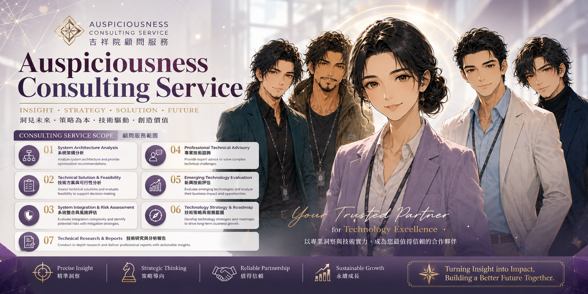

# RETA 專案型獨立技術策略與系統架構顧問服務合約   RETA PROJECT-BASED INDEPENDENT TECHNOLOGY STRATEGY AND SYSTEM ARCHITECTURE CONSULTING MASTER SERVICES AGREEMENT

  

**Version:** 1.0  
**Effective Date:** __________________

---

# 立約人 | PARTIES

甲方：潘貞元（以下稱「甲方」或「顧問」）  
Consultant: Pan, Jen-Yuan （the "Consultant"）  

乙方：______________________（以下稱「乙方」或「客戶」）  
Client: ______________________ （the "Client"）  

# 前言 | RECITALS

乙方因系統開發、軟體架構、技術策略、數位轉型及相關專業需求，委託甲方提供獨立技術策略與系統架構顧問服務。

WHEREAS, the Client desires to engage the Consultant to provide independent professional consulting services in connection with technology strategy, software architecture, system development, digital transformation, technical risk assessment, and related matters;

WHEREAS, the Consultant possesses the professional expertise, experience, and qualifications necessary to provide such services independently;

WHEREAS, the Parties intend to establish a project-based consulting relationship under which the scope, deliverables, schedule, and fees for each engagement shall be separately agreed upon in a [Statement of Work](SOW.md);

NOW, THEREFORE, in consideration of the mutual covenants and agreements set forth herein, the Parties agree as follows:

---

# 第一條　契約性質及期間
# Article 1 – Nature and Term of Agreement

### 1.1 主合約性質 | Master Agreement

本契約為雙方建立專案型獨立專業顧問合作關係之主合約（Master Services Agreement, MSA），適用於雙方依本契約另行成立之各個專案。

This Agreement constitutes a Master Services Agreement ("MSA") governing the general terms and conditions applicable to individual project-based consulting engagements undertaken by the Parties.

### 1.2 契約生效及期間 | Effective Date and Term

本契約自雙方簽署日起生效，除依本契約約定終止外，持續有效。

This Agreement shall become effective upon execution by both Parties and shall remain in effect until terminated in accordance with its terms.

### 1.3 個別專案成立 | Individual Project Engagements

每一專案均應由雙方另行簽署專案[工作說明書](SOW.md)（Statement of Work），載明服務範圍、專案目標、交付成果、執行時程、專案費用及付款條件。

Each project shall be initiated pursuant to a separately executed [Statement of Work](SOW.md) ("SOW") specifying the scope of Services, project objectives, Deliverables, project schedule, fees, and payment terms.

### 1.4 無持續服務義務 | No Ongoing Service Commitment

本契約之存在不構成甲方持續提供服務、保留固定服務時數、優先回應或隨時待命之義務。甲方僅於雙方簽署個別[工作說明書](SOW.md)後，始負有該專案之履約義務。

Nothing in this Agreement shall obligate the Consultant to provide continuous services, reserve consulting capacity, maintain fixed working hours, or remain on standby. The Consultant's obligations with respect to any project shall arise only upon execution of the applicable [SOW](SOW.md).

### 1.5 契約續約及延續 | Renewal and Continuation

本契約無須定期續約。雙方得依本契約持續簽署個別[工作說明書](SOW.md)。任何專案之延長或新增工作，均應經雙方書面確認。

This Agreement shall not require periodic renewal. The Parties may enter into additional [SOW](SOW.md)s from time to time. Any extension or expansion of an individual project shall require written agreement.

---

# 第二條　專案報酬及付款方式
# Article 2 – Project Fees and Payment Terms

### 2.1 專案費用 | Project Fees

各專案之顧問費用以該專案[工作說明書](SOW.md)所載金額為準，採專案固定總價（Fixed Project Fee）或雙方另行書面約定之計價方式。

The fees for each project shall be specified in the applicable [SOW](SOW.md) and may be structured as a fixed project fee or such other pricing arrangement as mutually agreed in writing.

### 2.2 專案費用涵蓋範圍 | Scope of Compensation

專案費用係甲方提供約定之專業顧問服務、研究、分析、技術評估、專業判斷及交付成果之對價。

The Project Fees constitute consideration for the Consultant's professional services, research, analysis, technical assessments, professional judgment, and agreed Deliverables.

### 2.3 分階段付款 | Milestone-Based Payments

除個別[工作說明書](SOW.md)另有約定外，專案費用依下列方式支付：

1. 專案啟動款：總專案費用之 40%，於[工作說明書](SOW.md)簽署後支付。
2. 中期款：總專案費用之 40%，於約定之中期成果交付後支付。
3. 結案款：總專案費用之 20%，於最終成果完成驗收後支付。

Unless otherwise specified in the applicable [SOW](SOW.md), the Project Fees shall be payable as follows:

1. Initial Payment: Forty percent (40%) of the total Project Fee upon execution of the [SOW](SOW.md).
2. Milestone Payment: Forty percent (40%) upon delivery of the agreed interim Deliverables.
3. Final Payment: Twenty percent (20%) upon acceptance of the final Deliverables.

### 2.4 付款期限 | Payment Due Date

乙方應於收到甲方請款文件後十四（14）日內完成付款，並匯入甲方指定帳戶。

The Client shall pay each invoice within fourteen (14) calendar days after receipt of the invoice, by wire transfer to the bank account designated by the Consultant.

### 2.5 逾期付款 | Late Payment

乙方未依約付款者，自應付款日之次日起至實際付款日止，按中華民國（臺灣）法律規定之法定遲延利率計付遲延利息。

Any overdue amount shall accrue interest from the day following its due date until paid in full, at the applicable statutory default interest rate under the laws of the Republic of China (Taiwan).

### 2.6 不得任意延後付款 | No Unjustified Payment Delays

乙方不得以內部驗收程序、簽核流程、預算核准程序、第三人付款安排或其他內部行政程序作為延後付款之理由。

The Client shall not withhold or delay payment due to internal approval procedures, procurement processes, budget authorization, acceptance administration, third-party payment arrangements, or other internal administrative matters.

### 2.7 逾期付款之服務暫停 | Suspension for Non-Payment

如乙方未支付已到期且無爭議之款項，甲方得以書面通知乙方於七（7）日內完成付款。屆期仍未付款者，甲方得暫停全部或部分服務，直至乙方完成付款。

If the Client fails to pay any undisputed amount when due, the Consultant may issue written notice requiring payment within seven (7) days. If payment is not received within such period, the Consultant may suspend all or part of the Services until the outstanding amount has been paid in full.

暫停期間內，甲方不負提供受影響服務之義務，相關交付期限應依實際暫停期間合理順延，且甲方不對因此產生之延誤負責。

During any such suspension, the Consultant shall have no obligation to perform the affected Services. Applicable delivery deadlines shall be reasonably extended to account for the suspension, and the Consultant shall not be liable for resulting delays.

### 2.8 稅務 | Taxes

雙方應依適用稅法各自履行其稅務義務。甲方應於合理及依法必要範圍內提供相關稅務資料。

Each Party shall be responsible for its respective tax obligations under applicable laws. The Consultant shall provide reasonably necessary tax documentation as required by applicable law.

### 2.9 不得任意扣款 | No Unauthorized Deductions or Set-Off

除依法應扣繳之稅款外，乙方不得未經甲方事前書面同意，任意扣減、抵銷或延遲支付任何應付款項。

Except for deductions or withholding required by applicable law, the Client shall not deduct, offset, withhold, or otherwise reduce any payment due to the Consultant without the Consultant's prior written consent.

---

# 第三條　顧問服務範圍
# Article 3 – Scope of Consulting Services

### 3.1 服務項目 | Consulting Services

甲方得依個別[工作說明書](SOW.md)約定提供下列一項或數項服務：

1. 系統架構分析及評估。
2. 技術方案研究、比較及可行性分析。
3. 系統整合及技術風險分析。
4. 技術策略及長期系統演進方向建議。
5. 新興技術、產品、平台及解決方案研究。
6. 技術決策支援及專業諮詢。
7. 特定技術議題研究及分析報告。
8. 其他雙方書面同意之專業顧問服務。

The Consultant may provide one or more of the following Services, as specified in the applicable [SOW](SOW.md):

(a) System architecture analysis and assessment;

(b) Technical solution research, comparison, and feasibility assessment;

(c) System integration review and technical risk assessment;

(d) Technology strategy and long-term system evolution recommendations;

(e) Research and evaluation of emerging technologies, products, platforms, and solutions;

(f) Technical decision support and professional advisory services;

(g) Research reports and analytical assessments addressing specific technical matters; and

(h) Other professional consulting services mutually agreed upon in writing.

### 3.2 服務範圍限制 | Scope Limitations

甲方之服務義務以本契約及個別[工作說明書](SOW.md)明確約定之內容為限。

The Consultant's obligations shall be strictly limited to the Services expressly specified in this Agreement and the applicable [SOW](SOW.md).

### 3.3 不包含之工程實作 | Excluded Implementation Services

除[工作說明書](SOW.md)明確約定外，顧問服務不包含軟體開發、系統建置、產品製造、部署、維運、現場支援或其他工程實作工作。

Unless expressly specified in the applicable [SOW](SOW.md), the Services shall not include software development, system implementation, product manufacturing, deployment, maintenance, on-site support, or other engineering execution activities.

### 3.4 額外服務 | Additional Services

乙方如要求超出原[工作說明書](SOW.md)範圍之服務，雙方應另行協議服務內容、費用、時程及交付成果。

Any services requested by the Client beyond the scope of the applicable [SOW](SOW.md) shall be treated as Additional Services and shall require separate written agreement regarding scope, fees, schedule, and Deliverables.

### 3.5 專業判斷基礎 | Basis of Professional Judgment

甲方之服務係基於服務當時可取得之資訊、乙方提供之資料、公開資訊及甲方合理之專業判斷。

The Services shall be performed based on information available at the relevant time, materials provided by the Client, publicly available information, and the Consultant's reasonable professional judgment.

### 3.6 不保證特定結果 | No Guarantee of Specific Results

除雙方另有明確書面約定外，甲方不保證乙方採用任何建議後必然達成特定商業結果、成本節省、效能、投資報酬、專案成功或其他特定目標。

Unless expressly agreed otherwise in writing, the Consultant makes no guarantee regarding business performance, cost savings, operational efficiency, return on investment, project success, implementation results, or any other specific outcome arising from the Client's use of the Services.

### 3.7 客戶決策責任 | Client's Responsibility for Decisions

乙方對是否採用甲方建議，以及其後之技術、商業、投資、採購、開發、整合、部署及營運決策，負最終決定及執行責任。

The Client shall retain sole responsibility for all decisions concerning the adoption, implementation, procurement, investment, integration, deployment, commercialization, and operation of any recommendations or Deliverables.

### 3.8 顧問意見之性質 | Nature of Advisory Services

甲方提供之研究、分析、評估、報告及建議，均屬專業顧問服務，供乙方作為決策參考，不構成強制性指示或結果保證。

All research, analyses, assessments, reports, and recommendations provided by the Consultant are advisory in nature and are intended to assist the Client's decision-making. They shall not constitute binding instructions or guarantees of specific outcomes.

除另有書面約定外，服務不構成法律、會計、稅務、投資、工程認證或法規遵循之專業意見或保證。

Unless expressly agreed otherwise in writing, the Services shall not constitute legal, accounting, tax, investment, engineering certification, or regulatory compliance advice or certification.

---

# 第四條　服務方式及執行模式
# Article 4 – Service Delivery Model

### 4.1 專案執行方式 | Project-Based Engagement

甲方依個別[工作說明書](SOW.md)約定之專案目標、工作範圍及交付時程提供服務。

The Consultant shall perform the Services in accordance with the project objectives, scope, and delivery schedule specified in the applicable [SOW](SOW.md).

### 4.2 工作自主性 | Professional Autonomy

甲方得自行安排研究、分析、文件準備及其他履約工作之時間與執行方式，但應遵守雙方約定之交付期限。

The Consultant shall independently determine the working methods, schedule, and procedures necessary to perform the Services, subject to the agreed project milestones and delivery deadlines.

### 4.3 遠端溝通 | Remote Communication

雙方得透過電子郵件、視訊會議、電子文件及其他雙方同意之遠端協作工具進行溝通及專案管理。

The Parties may communicate and coordinate project activities through email, video conferencing, electronic documents, and other mutually agreed remote collaboration tools.

### 4.4 無固定工時義務 | No Fixed Working Hours

除[工作說明書](SOW.md)另有約定外，甲方無提供固定每日工作時數、出勤、常駐或待命服務之義務。

Unless otherwise specified in the applicable [SOW](SOW.md), the Consultant shall not be subject to fixed daily working hours, attendance requirements, residency obligations, or standby requirements.

### 4.5 內部工作文件 | Internal Working Materials

除雙方另有書面約定外，甲方無須提供未列為正式交付成果之研究筆記、草稿、內部分析過程、工作底稿或其他內部文件。

Unless otherwise expressly agreed, the Consultant shall not be required to disclose research notes, preliminary drafts, internal analyses, working papers, or other internal materials that are not expressly identified as Deliverables.

---

# 第五條　交付成果及驗收
# Article 5 – Deliverables and Acceptance

### 5.1 交付成果 | Deliverables

甲方應依個別[工作說明書](SOW.md)所列項目、格式及時程交付約定成果。

The Consultant shall deliver the Deliverables specified in the applicable [SOW](SOW.md) in the agreed format and within the agreed schedule.

### 5.2 交付形式 | Delivery Format

交付成果得以電子文件、技術報告、簡報、分析文件、架構圖或其他雙方約定之形式提供。

Deliverables may include electronic documents, technical reports, presentations, analytical reports, architecture diagrams, or other formats mutually agreed upon by the Parties.

### 5.3 驗收期間 | Acceptance Period

乙方應於收到交付成果後七（7）個工作日內完成審查，並以書面提出具體異議。

The Client shall review each Deliverable within seven (7) Business Days following receipt and provide written notice of any specific non-conformity.

### 5.4 驗收標準 | Acceptance Criteria

乙方提出異議時，應具體指出交付成果未符合[工作說明書](SOW.md)所載驗收標準之項目及理由。

Any rejection or objection shall identify the specific aspects of the Deliverable that materially fail to conform to the acceptance criteria expressly set forth in the applicable [SOW](SOW.md), together with reasonable supporting details.

### 5.5 合理修正 | Reasonable Revisions

甲方應於原約定服務範圍內，針對合理且具體之異議進行必要修正或補充。

The Consultant shall make reasonable corrections or clarifications to address valid objections, provided that such revisions remain within the originally agreed scope of Services.

### 5.6 視為驗收 | Deemed Acceptance

乙方於前述驗收期間內未提出具體書面異議者，該交付成果視為已完成驗收。

If the Client fails to provide a specific written objection within the applicable Acceptance Period, the relevant Deliverable shall be deemed accepted.

乙方將交付成果投入實際商業使用、正式部署或提供第三方使用者，亦視為已接受該成果，但雙方另有書面約定者除外。

The Client's commercial use, production deployment, or distribution of a Deliverable to third parties shall also constitute acceptance, unless otherwise agreed in writing.

### 5.7 超出範圍之修改 | Out-of-Scope Revisions

新增研究方向、額外功能、服務內容擴張或超出原[工作說明書](SOW.md)之修改，不屬於甲方免費修正義務。

Requests for additional research, new functionality, expanded Services, or modifications beyond the original [SOW](SOW.md) shall constitute Additional Services and shall be separately quoted.

---

# 第六條　遠端服務及出差限制
# Article 6 – Remote-Only Services and No Travel

### 6.1 遠端服務原則 | Remote-Only Engagement

雙方確認，本契約及其所有[工作說明書](SOW.md)所約定之顧問服務均採遠端方式執行。

The Parties expressly agree that all Services provided under this Agreement and any [SOW](SOW.md) shall be performed remotely.

### 6.2 不提供出差服務 | No Business Travel

甲方不提供任何國內或國際出差、客戶指定地點之實體會議、工廠訪視、現場評估、駐點或其他須實際前往指定地點之服務。

The Consultant shall not be required to undertake domestic or international business travel, attend in-person meetings at Client-designated locations, visit factories or facilities, conduct on-site assessments, provide on-site support, or perform any Services requiring physical attendance at a designated location.

### 6.3 不得要求現場服務 | No Mandatory On-Site Attendance

乙方不得要求甲方以出差、實體到場、駐點或其他非遠端方式履行本契約。

The Client shall not require the Consultant to perform any Services through business travel, physical attendance, on-site engagement, or other non-remote arrangements.

### 6.4 遠端服務費用 | Remote Service Fees

本契約所約定之專案費用係以遠端服務模式為基礎，不包含任何出差、交通、住宿或其他差旅費用。

The Project Fees are based exclusively on a remote service delivery model and do not include any business travel, transportation, accommodation, or other travel-related expenses.

---

# 第七條　專案變更管理
# Article 7 – Project Change Control

### 7.1 變更需求 | Change Requests

任一方如需變更專案目標、工作範圍、交付成果、執行時程或費用，應提出書面變更需求。

Either Party may propose changes to the project objectives, scope, Deliverables, schedule, or fees by submitting a written Change Request.

### 7.2 變更評估 | Change Assessment

甲方應評估變更對專案工作內容、資源投入、交付時程及費用之影響。

The Consultant shall assess the impact of the proposed change on the project scope, resource requirements, delivery schedule, and fees.

### 7.3 變更確認 | Written Change Order

任何專案變更均應經雙方書面確認，必要時以修訂[工作說明書](SOW.md)或另行簽署之變更單（Change Order）辦理。

No project change shall become effective unless approved in writing by both Parties through an amended [SOW](SOW.md) or a separate Change Order.

### 7.4 未經核准之工作 | Unauthorized Work

未經雙方書面確認之新增需求，甲方無執行義務，亦不構成原專案之交付義務。

The Consultant shall have no obligation to perform any additional work that has not been approved in writing by both Parties, and such work shall not form part of the original project obligations.

### 7.5 時程調整 | Schedule Adjustments

因乙方延遲提供資料、確認、決策或其他必要協助，致影響專案進度者，相關交付期限應合理順延。

If project progress is affected by the Client's delay in providing information, approvals, decisions, or other required cooperation, the applicable delivery deadlines shall be reasonably extended.

---

# 第八條　保密責任
# Article 8 – Confidentiality

### 8.1 機密資訊定義 | Definition of Confidential Information

機密資訊係指乙方以書面、電子、口頭或其他方式向甲方揭露，且於揭露時合理可認定具有保密性質之非公開資訊，包括營業秘密、技術資料、設計文件、原始碼、產品規劃、客戶資料及商業策略。

"Confidential Information" means any non-public information disclosed by the Client to the Consultant in written, electronic, oral, visual, or other form that is reasonably understood to be confidential, including trade secrets, technical information, designs, source code, product plans, customer information, and business strategies.

### 8.2 口頭揭露資訊 | Oral Disclosures

以口頭方式揭露之資訊，乙方應於揭露時告知其機密性質，並於揭露後三十（30）日內以書面確認。

For information disclosed orally, the Client shall identify its confidential nature at the time of disclosure and confirm such designation in writing within thirty (30) days thereafter.

### 8.3 保密義務 | Confidentiality Obligations

甲方僅得於履行本契約之必要範圍內使用乙方機密資訊，非經乙方事前書面同意，不得向第三人揭露或作其他未經授權之使用。

The Consultant shall use the Client's Confidential Information solely for purposes of performing the Services and shall not disclose or otherwise use such information without the Client's prior written consent, except as permitted herein.

### 8.4 一般知識及 Know-How | General Knowledge and Know-How

甲方因其既有知識、技能、專業經驗、分析方法、架構設計能力及履約過程中累積之一般性 Know-how，不因接觸乙方資訊而喪失使用權利。

Nothing in this Agreement shall restrict the Consultant's use of pre-existing knowledge, professional skills, experience, analytical methods, architectural expertise, or generalized know-how developed through professional practice, provided that the Client's Confidential Information is not disclosed or improperly used.

### 8.5 機密資訊排除 | Exclusions

下列資訊不屬機密資訊：

(a) 甲方於揭露前已合法知悉之資訊；

(b) 於揭露時已公開之資訊；

(c) 非因甲方違約而成為公開之資訊；

(d) 甲方未使用乙方機密資訊而獨立開發之資訊；

(e) 甲方既有之專業知識、方法論及一般性 Know-how；或

(f) 依法令、法院或主管機關要求必須揭露之資訊。

Confidential Information shall not include information that:

(a) was lawfully known to the Consultant prior to disclosure;

(b) was publicly available at the time of disclosure;

(c) becomes publicly available without breach of this Agreement;

(d) is independently developed without use of the Client's Confidential Information;

(e) constitutes the Consultant's pre-existing professional knowledge, methodologies, or generalized know-how; or

(f) is required to be disclosed by applicable law, regulation, court order, or governmental authority.

### 8.6 法定揭露 | Required Disclosure

甲方依法必須揭露乙方機密資訊時，應於法律允許範圍內事前通知乙方。

Where disclosure is legally required, the Consultant shall, to the extent legally permissible, provide the Client with prompt prior notice.

### 8.7 保密期間 | Survival of Confidentiality Obligations

保密義務於本契約終止或屆滿後五（5）年內繼續有效；依法屬營業秘密者，於其依法仍具營業秘密性質期間持續受到保護。

The confidentiality obligations shall survive for five (5) years following termination or expiration of this Agreement. Trade secrets shall remain protected for so long as they qualify as trade secrets under applicable law.

### 8.8 資料返還及刪除 | Return or Destruction

契約終止或乙方合理要求時，甲方應於合理範圍內返還或刪除乙方機密資訊，但依法必須保存、正常備份機制所留存或為舉證所必要者除外。

Upon termination or the Client's reasonable request, the Consultant shall return or securely destroy the Client's Confidential Information, except for information required to be retained by law, routine backup systems, or legitimate evidentiary purposes.

---

# 第九條　智慧財產權
# Article 9 – Intellectual Property Rights

### 9.1 既有智慧財產權之保留 | Background Intellectual Property

甲方於本契約成立前已擁有、開發、取得或合法使用之所有智慧財產權、專有技術、方法論、架構、分析模型、程式、工具、模板、文件、研究成果、流程、商業知識及其他相關權利（以下統稱「既有智慧財產權」），均為甲方或其合法權利人所有。

All intellectual property rights, proprietary know-how, methodologies, frameworks, analytical models, software, tools, templates, documentation, research materials, processes, business knowledge, and related rights owned, developed, acquired, or lawfully used by the Consultant prior to the Effective Date (collectively, "Background Intellectual Property") shall remain the exclusive property of the Consultant or their respective lawful owners.

本契約之簽訂、履行、終止或交付成果之提供，均不構成該等既有智慧財產權之讓與、出售或其他權利移轉。

Neither the execution nor performance of this Agreement, nor the delivery of any Deliverables, shall be construed as an assignment, sale, or transfer of any Background Intellectual Property.

### 9.2 可重複利用成果及 Know-How | Reusable Intellectual Assets and Know-How

除雙方另有明確書面約定外，甲方於履行本契約過程中所形成、改良、發展或累積之通用架構、分析模型、設計模式、演算法、技術方法論、開發流程、框架、工具、最佳實務、專業經驗、技能及一般性 Know-How，均歸甲方所有。

Unless otherwise expressly agreed in writing, all reusable methodologies, frameworks, analytical models, design patterns, algorithms, technical processes, software tools, best practices, professional experience, skills, and generalized know-how developed, enhanced, or acquired by the Consultant in connection with the Services shall remain the exclusive property of the Consultant.

甲方得於不揭露乙方機密資訊之前提下，自由使用、修改、發展、授權或商業化前述成果。

The Consultant shall remain entitled to use, modify, develop, license, commercialize, and otherwise exploit such reusable intellectual assets and know-how, provided that no Confidential Information of the Client is disclosed or misused.

### 9.3 專案交付成果之著作財產權 | Copyright Ownership of Project Deliverables

甲方依乙方特定委託所完成，且於[工作說明書](SOW.md)中明確列為交付成果之報告、分析文件、建議書、簡報、架構設計文件及其他專案成果（以下稱「專案交付成果」），其著作財產權於乙方完成該專案全部應付款項後，始移轉予乙方。

The economic copyright interests in reports, analytical documents, recommendations, presentations, architectural design documents, and other work products specifically commissioned by the Client and expressly identified as Deliverables in the applicable [SOW](SOW.md) (collectively, "Project Deliverables") shall vest in the Client only upon the Client's full payment of all fees and other amounts due in respect of the relevant project.

甲方保留依法不得讓與之著作人格權及其他權利。

The Consultant shall retain all moral rights and any other rights that may not be assigned under applicable law.

### 9.4 付款前之權利保留 | Reservation of Rights Pending Full Payment

於乙方完成該專案全部應付款項前，專案交付成果之著作財產權仍歸甲方所有。

Until the Client has paid all amounts due in full in respect of the relevant project, all economic copyright interests in the Project Deliverables shall remain with the Consultant.

乙方於付款完成前，僅得於專案內部審查、評估及驗收之必要範圍內使用已交付成果，不得將其對外散布、轉售、授權第三方、商業化或移作其他專案用途。

Prior to full payment, the Client may use the delivered Project Deliverables solely for internal review, evaluation, and acceptance purposes. The Client shall not distribute, resell, sublicense, commercialize, or use such Deliverables for any other project or purpose.

乙方不得以已收到文件、已進行內部審查、已召開成果簡報或已開始使用部分成果為由，主張相關智慧財產權已自動移轉。

The Client shall not claim that any intellectual property rights have automatically transferred merely because the Deliverables have been received, reviewed, presented, or partially used.

### 9.5 付款完成後之客戶權利 | Client Rights Upon Full Payment

乙方完成該專案全部應付款項後，得於合法範圍內永久使用、重製、修改、展示及管理已取得權利之專案交付成果。

Upon full payment of all amounts due for the relevant project, the Client may permanently use, reproduce, modify, display, and maintain the Project Deliverables in accordance with applicable law.

乙方得於合理必要範圍內提供其關係企業、員工、顧問、系統整合商及專案相關合作廠商使用，以利專案實施、營運、維護及支援。

The Client may make the Project Deliverables available to its Affiliates, employees, consultants, system integrators, contractors, and project participants to the extent reasonably necessary for implementation, operation, maintenance, and support.

### 9.6 既有技術之使用授權 | License to Embedded Background Intellectual Property

如專案交付成果包含甲方既有智慧財產權或可重複使用之技術元件，甲方仍保有該等智慧財產權之所有權。

Where any Project Deliverable incorporates or depends upon the Consultant's Background Intellectual Property or reusable technical components, ownership of such intellectual property shall remain with the Consultant.

於乙方完成該專案全部應付款項後，甲方授予乙方永久、全球性、非專屬、免權利金之使用授權，使乙方得於使用專案交付成果所必要之範圍內使用該等嵌入式技術元件。

Upon full payment of all amounts due for the relevant project, the Consultant grants the Client a perpetual, worldwide, non-exclusive, royalty-free license to use such embedded Background Intellectual Property solely to the extent necessary for the Client's use of the Project Deliverables.

前述授權不包含將甲方既有技術、工具、框架、模型或 Know-how 獨立抽離、轉售、再授權或作為獨立產品提供第三人之權利。

Such license shall not permit the Client to extract, resell, sublicense, distribute, or commercially exploit the Consultant's Background Intellectual Property, tools, frameworks, models, or know-how as standalone products or services.

### 9.7 禁止未經授權之商業化 | Restriction on Commercialization

除雙方另有書面約定外，乙方不得將甲方之方法論、框架、模型、工具、程式、演算法或其他既有智慧財產權作為獨立產品、服務或商業化方案提供第三人。

Unless otherwise expressly agreed in writing, the Client shall not commercialize, resell, sublicense, distribute, or provide the Consultant's methodologies, frameworks, models, tools, software, algorithms, or other Background Intellectual Property to third parties as standalone products or services.

### 9.8 特別智慧財產權移轉 | Separate Intellectual Property Assignment

如乙方要求取得軟體原始碼、演算法、模型、框架、工具或其他智慧財產權之全部或部分所有權，雙方應另行簽署書面協議，明確約定移轉範圍、權利內容及對價。

Any assignment, exclusive license, transfer of ownership, or transfer of source code, algorithms, models, frameworks, tools, or other intellectual property beyond the rights expressly granted herein shall require a separate written agreement specifying the scope of rights transferred and the corresponding consideration.

### 9.9 非交付項目 | Excluded Materials

除[工作說明書](SOW.md)明確列為交付成果外，甲方無提供下列項目之義務：

(a) 原始碼；

(b) 模型訓練資料；

(c) 模型建置檔；

(d) 開發環境；

(e) 內部工具；

(f) 研究筆記；

(g) 內部分析過程文件；或

(h) 其他未明確列為交付成果之內部技術資料。

Unless expressly identified as Deliverables in the applicable [SOW](SOW.md), the Consultant shall have no obligation to provide:

(a) source code;

(b) model training datasets;

(c) model construction files;

(d) development environments;

(e) internal tools;

(f) research notes;

(g) internal analytical working papers; or

(h) other internal technical materials.

### 9.10 軟體開發專案 | Software Development Engagements

如個別專案主要內容為軟體、系統、工具或模組開發，而非專業顧問服務，雙方應另行協議智慧財產權、原始碼交付、維護及技術支援事項。

Where an engagement primarily involves software, system, tool, or module development rather than professional consulting services, the Parties shall enter into a separate written agreement addressing intellectual property ownership, source code delivery, maintenance, and technical support.

---

# 第十條　法律關係及獨立顧問身分
# Article 10 – Independent Contractor Relationship

### 10.1 獨立顧問 | Independent Contractor

甲方係以獨立專業顧問身分提供服務，並非乙方之員工、代理人、合夥人或法定代表人。

The Consultant is engaged as an independent contractor and not as an employee, agent, partner, joint venturer, or legal representative of the Client.

### 10.2 無代理權限 | No Authority to Bind Client

除雙方另有書面約定外，甲方無權代表乙方對外簽署契約、作成承諾或使乙方負擔法律義務。

Except as expressly authorized in writing, the Consultant shall have no authority to enter into agreements, make commitments, or otherwise bind the Client.

### 10.3 無員工福利資格 | No Employee Benefits

甲方不因本契約取得乙方員工身分、員工福利、退休金或其他僅適用於乙方員工之權利。

Nothing in this Agreement shall entitle the Consultant to employee status, employee benefits, retirement benefits, insurance programs, or other employment-related entitlements provided by the Client.

### 10.4 工作自主性 | Independence

甲方得自行決定履行服務所需之工作方式、工具、時間及地點，但應符合約定之專案交付成果及時程。

The Consultant shall independently determine the methods, tools, working hours, and location necessary to perform the Services, subject to the agreed Deliverables and project schedule.

### 10.5 法律關係認定 | Characterization of Relationship

雙方確認，本契約係雙方真實意思表示。惟雙方間法律關係之認定，仍應依實際履約情形及適用法令判斷。

The Parties acknowledge their mutual intention to establish an independent consulting relationship. The legal characterization of such relationship shall nevertheless be determined in accordance with the actual conduct of the Parties and applicable law.

---

# 第十一條　資料及資訊安全
# Article 11 – Data Protection and Information Security

### 11.1 資料使用限制 | Permitted Use of Client Information

甲方僅得於執行本契約所必要之範圍內使用乙方提供之資料。

The Consultant shall use the Client's information, data, records, documents, and materials solely to the extent reasonably necessary to perform the Services.

### 11.2 合理資訊安全措施 | Reasonable Security Measures

甲方應採取一般商業上合理之資訊安全措施，包括：

(a) 帳號及密碼保護；

(b) 作業系統及安全軟體合理更新；

(c) 機密資料權限控管；及

(d) 合理資料備份措施。

The Consultant shall implement commercially reasonable administrative, technical, and organizational safeguards, including:

(a) account and password protection;

(b) reasonable system and security software updates;

(c) appropriate access controls; and

(d) reasonable data backup measures.

### 11.3 安全義務限制 | Limitation of Security Obligations

資訊安全措施以獨立專業顧問依其工作環境可合理採行之措施為限。

Such safeguards shall be appropriate to the Consultant's role and independent professional working environment.

### 11.4 無企業級資安認證義務 | No Enterprise Certification Requirement

除雙方另有書面約定外，甲方無義務取得或維持 ISO 27001、SOC 2、NIST、Zero Trust 或其他企業級資訊安全認證。

Unless otherwise expressly agreed in writing, the Consultant shall have no obligation to obtain or maintain ISO 27001, SOC 2, NIST, Zero Trust, or other enterprise-level security certifications.

### 11.5 特殊資訊安全要求 | Special Security Requirements

乙方如有特殊資安要求，應於提供資料前以書面通知甲方，雙方另行協議必要措施、成本及執行方式。

If the Client requires special security controls, the Client shall notify the Consultant in writing before providing the relevant information. The Parties shall separately agree upon the required safeguards, costs, and implementation arrangements.

### 11.6 資料返還及刪除 | Return and Destruction of Data

契約終止後，甲方應依乙方合理要求返還或刪除乙方提供之資料，但依法必須保存、正常備份機制或為舉證所必要保留者除外。

Upon termination, the Consultant shall return or securely destroy the Client's information upon reasonable request, except for information required to be retained by law, routine backup systems, or legitimate evidentiary purposes.

---

# 第十二條　個人資料
# Article 12 – Personal Data Protection

### 12.1 法令遵循 | Compliance with Data Protection Laws

如服務涉及個人資料之蒐集、處理、利用、傳輸或儲存，雙方應遵守適用之個人資料保護及隱私相關法令。

Each Party shall comply with applicable data protection and privacy laws in connection with the collection, processing, use, transfer, or storage of personal data.

### 12.2 個人資料處理協議 | Data Processing Agreement

如服務內容確有必要，雙方應另行簽訂個人資料處理協議（Data Processing Agreement）或其他相關資料安全協議。

Where required by the nature of the Services, the Parties shall enter into a separate Data Processing Agreement or other appropriate data security agreement.

### 12.3 顧問角色限制 | Limitation of Consultant's Data Management Role

除雙方另有書面約定外，甲方並非乙方之資料託管服務提供者、雲端服務供應商、代管服務提供者或專責資料處理機構。

Unless otherwise expressly agreed in writing, the Consultant is not engaged as a data hosting provider, cloud service provider, managed service provider, or dedicated data processor.

甲方對乙方營運系統或個人資料環境不負持續監控、管理、維護或法規遵循義務。

The Consultant shall have no ongoing responsibility for the monitoring, administration, maintenance, or regulatory compliance of the Client's operational systems or personal data environments.

### 12.4 敏感及受管制資料 | Sensitive and Regulated Data

如乙方要求甲方接觸醫療、金融、政府管制或其他受特別保護之資料，雙方應另行簽署書面協議。

If the Client requires the Consultant to access sensitive healthcare, financial, government-controlled, or other specially protected data, the Parties shall enter into a separate written agreement addressing the applicable legal and security requirements.

---

# 第十三條　顧問責任及責任限制
# Article 13 – Professional Responsibility and Limitation of Liability

### 13.1 專業注意義務 | Standard of Professional Care

甲方應以合理之專業注意義務提供顧問服務，並依服務當時可取得之資料及合理專業判斷完成工作。

The Consultant shall perform the Services with the degree of care, skill, diligence, and professional judgment reasonably expected of an experienced independent consultant providing similar services.

### 13.2 客戶資訊責任 | Reliance on Client-Provided Information

乙方應提供甲方進行專業判斷所必要之相關資料。

The Client shall provide all information reasonably necessary for the Consultant to perform the Services.

因乙方提供之資料不完整、不正確、過時、具誤導性或事後變更，致影響分析或建議者，甲方不對因此產生之結果負責。

The Consultant shall not be responsible for any consequences arising from incomplete, inaccurate, outdated, misleading, omitted, or subsequently modified information supplied by the Client or third parties.

### 13.3 不保證特定結果 | No Guarantee of Results

甲方之服務係提供專業研究、分析、評估及建議，不構成對商業績效、成本節省、投資報酬、專案成功、法規遵循或其他特定結果之保證。

The Services are advisory in nature and shall not constitute any guarantee regarding business performance, cost savings, return on investment, project success, regulatory compliance, or other specific outcomes.

### 13.4 客戶決策及執行責任 | Client Responsibility

乙方對是否採用甲方建議，以及後續投資、採購、開發、修改、整合、部署、商業化及營運決策，負最終責任。

The Client shall retain sole responsibility for all decisions concerning the adoption, investment, procurement, development, modification, integration, deployment, commercialization, and operation of any recommendations or Deliverables.

甲方不對乙方採用、部分採用、修改、拒絕或未依從甲方建議所產生之商業結果或損失負責，但依法不得免除之責任除外。

The Consultant shall not be liable for business outcomes or losses arising from the Client's adoption, partial adoption, modification, rejection, or failure to follow the Consultant's recommendations, except to the extent such liability cannot be excluded under applicable law.

### 13.5 排除間接及衍生性損害 | Exclusion of Indirect and Consequential Damages

除甲方故意、重大過失或依法不得限制責任之情形外，甲方不對下列損害負責：

(a) 間接損害；

(b) 衍生性損害；

(c) 逸失利益；

(d) 營業損失；

(e) 商機損失；

(f) 商譽損失；

(g) 營業中斷；或

(h) 資料損失。

Except for liability arising from the Consultant's willful misconduct, gross negligence, or circumstances where liability cannot legally be excluded, the Consultant shall not be liable for any:

(a) indirect damages;

(b) consequential damages;

(c) loss of profits;

(d) loss of revenue;

(e) loss of business opportunities;

(f) loss of goodwill;

(g) business interruption; or

(h) loss of data.

### 13.6 責任上限 | Limitation of Liability Cap

除甲方故意、重大過失、詐欺或依法不得限制責任之情形外，甲方因個別專案所負之累計損害賠償責任，以該專案乙方實際支付之顧問費總額為上限。

Except for liability arising from the Consultant's willful misconduct, gross negligence, fraud, or circumstances where liability may not be limited under applicable law, the Consultant's aggregate liability arising out of or relating to an individual project shall not exceed the total Project Fees actually paid by the Client for that project.

### 13.7 責任限制適用範圍 | Scope of Liability Limitation

前項責任限制適用於因本契約或個別專案所生之一切請求，不論其法律依據為契約、侵權、不完全給付或其他法律關係。

The foregoing limitation shall apply to all claims arising out of or relating to this Agreement or the applicable project, regardless of the legal theory, including contract, tort, negligence, or any other cause of action.

### 13.8 第三人智慧財產權爭議 | Third-Party Intellectual Property Claims

如涉及第三人智慧財產權爭議，甲方之責任以該爭議係因甲方故意或重大過失直接造成者為限，但依法不得限制之責任除外。

With respect to third-party intellectual property claims, the Consultant shall be liable only to the extent that the claim directly results from the Consultant's willful misconduct or gross negligence, except where such limitation is prohibited by law.

### 13.9 第三方技術責任 | Third-Party Technology Disclaimer

甲方不保證第三方產品、服務、軟體、開源軟體或其他第三方技術之合法性、可用性、授權完整性、商業適用性或持續支援。

The Consultant does not warrant or guarantee the legality, availability, licensing status, intellectual property status, commercial suitability, or continued support of any third-party products, services, software, open-source software, or technologies.

### 13.10 按現況提供 | AS IS and AS AVAILABLE

除本契約明確約定者外，甲方所提供之服務、分析、建議及交付成果均按「現況」（AS IS）及「現有可用狀態」（AS AVAILABLE）提供。

Except as expressly stated in this Agreement, all Services, analyses, recommendations, and Deliverables are provided on an "AS IS" and "AS AVAILABLE" basis.

甲方不提供任何明示、默示或法定保證，包括適售性、特定目的適用性或特定結果之保證，但依法不得排除者除外。

The Consultant disclaims all express, implied, and statutory warranties, including warranties of merchantability, fitness for a particular purpose, and achievement of any specific result, except to the extent such disclaimers are prohibited by applicable law.

---

# 第十四條　第三方資訊及技術方案
# Article 14 – Third-Party Information and Technologies

### 14.1 第三方資料之使用 | Use of Third-Party Information

甲方得於必要範圍內引用公開技術資料、第三方產品文件、開源軟體、產業標準及其他第三方資訊。

The Consultant may reference, evaluate, analyze, or incorporate publicly available information, third-party documentation, open-source software, industry standards, and other third-party resources as reasonably necessary for the Services.

### 14.2 第三方授權提醒 | Third-Party Licensing Notice

如特定第三方產品、服務或授權條件可能重大影響乙方使用，甲方應於合理可行範圍內提醒乙方。

Where reasonably apparent, the Consultant shall use commercially reasonable efforts to notify the Client of material licensing restrictions or usage limitations associated with relevant third-party products or technologies.

### 14.3 第三方方案採用決策 | Client's Adoption Decisions

乙方是否採用第三方產品、服務或技術方案，由乙方自行決定。

The decision whether to acquire, license, adopt, implement, or use any third-party product, service, or technology shall remain solely with the Client.

### 14.4 第三方權利及法規責任 | Third-Party Rights and Compliance

乙方應自行確認相關授權、契約、法規及商業條件。

The Client shall be solely responsible for evaluating and complying with all applicable licensing terms, contractual obligations, legal requirements, regulatory requirements, and commercial conditions associated with any third-party solution.

### 14.5 無持續監控義務 | No Ongoing Monitoring Obligation

甲方無義務於專案完成後持續監控第三方產品、技術、授權條件、價格、技術路線圖或法規之變動。

The Consultant shall have no obligation to monitor, update, or notify the Client of subsequent changes to third-party products, technologies, licensing terms, pricing, technology roadmaps, or regulatory requirements after completion of the applicable Services.

---

# 第十五條　非排他性
# Article 15 – Non-Exclusivity

### 15.1 非排他合作 | Non-Exclusive Engagement

除雙方另有書面約定外，本契約不具有排他性。

This Agreement is non-exclusive. Nothing herein shall restrict the Consultant from providing services to other clients or pursuing independent business opportunities.

### 15.2 其他客戶服務 | Services to Other Clients

甲方得為其他客戶提供服務，但不得洩漏或不當使用乙方機密資訊。

The Consultant may provide services to other clients, provided that the Consultant does not disclose or misuse the Client's Confidential Information.

### 15.3 類似技術領域服務 | Similar Technical Engagements

甲方為其他客戶提供相同或類似技術領域之研究、分析、架構及顧問服務，不因其內容相似而當然構成違約。

The provision of services involving similar technologies, industries, business domains, or technical disciplines shall not, by itself, constitute a breach of this Agreement.

### 15.4 持續使用既有智慧財產 | Continued Use of Consultant's Intellectual Property

甲方得於不揭露乙方機密資訊之前提下，持續發展、改進、使用、授權或商業化其既有智慧財產及通用技術成果。

The Consultant may continue to develop, improve, use, license, and commercialize the Consultant's own intellectual property and reusable technical assets, provided that the Client's Confidential Information is not disclosed or improperly used.

---

# 第十六條　利益衝突
# Article 16 – Conflicts of Interest

### 16.1 利益衝突通知 | Conflict Disclosure

甲方如發現其與其他客戶之合作可能產生重大且實質之利益衝突，應於合理可行範圍內通知乙方。

If the Consultant becomes aware of a material and substantive conflict of interest that could reasonably impair the Consultant's ability to perform the Services, the Consultant shall notify the Client within a commercially reasonable period.

### 16.2 一般專業能力之使用 | Use of General Professional Knowledge

一般技術知識、專業經驗、公開資訊、通用方法論及可移轉之技術能力，不因本條而當然構成利益衝突。

The use of general technical knowledge, professional experience, publicly available information, generalized methodologies, and transferable technical skills shall not, in itself, constitute a conflict of interest.

### 16.3 特殊限制之書面約定 | Special Restrictions

如乙方要求對特定客戶、專案、產業或技術領域設定特殊限制，雙方應另行約定限制範圍、期間及相關商業補償。

Any special restriction relating to specific clients, projects, industries, or technologies shall require a separate written agreement specifying the scope, duration, and associated commercial compensation.

### 16.4 無競業禁止義務 | No Non-Competition Obligation

除雙方另有書面約定外，本契約不構成任何競業禁止、業務排他或市場限制義務。

Unless otherwise expressly agreed in writing, this Agreement shall not impose any non-competition, exclusivity, or market restriction on the Consultant.

### 16.5 競業限制之個別約定 | Separate Non-Competition Arrangements

任何競業禁止或排他合作要求，均應另行簽訂書面協議，並明確約定限制範圍、期間及合理補償。

Any non-competition or exclusivity obligation shall be subject to a separate written agreement specifying the applicable scope, duration, and reasonable compensation.

---

# 第十七條　不得挖角及規避合作
# Article 17 – Non-Solicitation and Non-Circumvention

### 17.1 禁止挖角 | Non-Solicitation

於本契約期間及終止後一年內，乙方不得直接或間接招攬、聘僱或委任甲方因履行本契約而介紹、安排、管理或實際使用之顧問、專家、分包商或其他專業人員，致其終止或減少與甲方之合作關係。

During the term of this Agreement and for one (1) year thereafter, the Client shall not directly or indirectly solicit, recruit, hire, or engage any consultant, specialist, subcontractor, or other professional introduced, arranged, managed, or utilized by the Consultant in connection with the Services in a manner that causes such person to terminate or reduce their relationship with the Consultant.

### 17.2 禁止規避合作 | Non-Circumvention

未經甲方事前書面同意，乙方不得規避甲方而直接與前述人員建立聘僱、顧問、承攬或其他類似商業關係。

Without the Consultant's prior written consent, the Client shall not circumvent the Consultant by directly establishing an employment, consulting, contracting, or similar commercial relationship with such persons.

### 17.3 既有關係之例外 | Independent Relationship Exception

如乙方於接觸相關人員前，已透過獨立來源合法知悉並建立合作關係，前述限制不適用；乙方應負舉證責任。

The foregoing restrictions shall not apply where the Client can demonstrate that it independently knew and had established a business relationship with the relevant person or entity before being introduced by the Consultant.

### 17.4 商業關係之保留 | Reservation of Business Relationships

甲方既有客戶、合作夥伴、供應商、顧問網絡及專家網絡，均屬甲方之商業資源，不因本契約而移轉予乙方。

The Consultant's existing clients, business partners, suppliers, professional networks, and expert networks shall remain the Consultant's business assets and shall not be transferred to the Client by virtue of this Agreement.

### 17.5 違反之救濟 | Remedies

乙方違反本條時，甲方得依法請求損害賠償及其他適當救濟。雙方如需約定違約金，應於個別[工作說明書](SOW.md)或補充協議中另行明確約定。

In the event of a breach of this Article, the Consultant may seek damages and other remedies available under applicable law. Any contractual liquidated damages shall be expressly agreed upon in the applicable [SOW](SOW.md) or a separate written agreement.

---

# 第十八條　契約及專案終止
# Article 18 – Termination

### 18.1 主合約任意終止 | Termination for Convenience

任一方得提前三十（30）日以書面通知他方終止本主合約。

Either Party may terminate this Agreement for convenience by providing at least thirty (30) days' prior written notice to the other Party.

### 18.2 個別專案終止 | Termination of Individual Projects

個別專案之提前終止，應依該專案[工作說明書](SOW.md)所約定之終止條件辦理。除另有約定外，任一方得提前三十（30）日以書面通知終止個別專案。

Termination of an individual project shall be governed by the termination provisions of the applicable [SOW](SOW.md). Unless otherwise specified, either Party may terminate an individual project upon thirty (30) days' prior written notice.

### 18.3 專案終止費用結算 | Project Fee Settlement

專案提前終止時，乙方仍應支付截至終止生效日已完成之工作、已交付成果及已發生之合理必要費用。

Upon early termination of a project, the Client shall remain responsible for payment of all Services performed, Deliverables completed, and reasonable expenses incurred up to the effective termination date.

### 18.4 預付款處理 | Treatment of Advance Payments

已支付之預付款應依專案實際執行進度及雙方約定之終止結算方式處理。尚未執行部分之費用，依[工作說明書](SOW.md)約定或雙方書面協議辦理退還或結算。

Advance payments shall be accounted for based on the actual progress of the project and the applicable termination settlement provisions. Any amounts attributable to unperformed Services shall be refunded or otherwise settled in accordance with the [SOW](SOW.md) or a written agreement between the Parties.

### 18.5 進行中交付成果 | Work in Progress

專案終止時，雙方應就已完成工作、未完成工作、應付費用及部分完成之交付成果進行確認。

Upon termination, the Parties shall determine the extent of work completed, outstanding work, applicable compensation, and the treatment of partially completed Deliverables.

### 18.6 因違約而終止 | Termination for Cause

任一方重大違反本契約，經他方書面通知並給予十（10）日改善期間而仍未改善者，他方得終止本契約或受影響之專案。

Either Party may terminate this Agreement or the affected project if the other Party materially breaches this Agreement and fails to cure such breach within ten (10) days after receiving written notice.

### 18.7 逾期付款之終止權 | Termination for Non-Payment

乙方未支付到期款項，經甲方書面催告後仍未於十（10）日內完成付款者，甲方得終止本契約或相關專案。

The Consultant may terminate this Agreement or the relevant project if the Client fails to pay any overdue amount within ten (10) days after receiving written notice demanding payment.

### 18.8 終止後存續條款 | Survival

契約終止不影響終止前已產生之付款、保密、智慧財產權、責任限制及其他依其性質應繼續有效之權利義務。

Termination shall not affect accrued payment obligations or any provisions relating to confidentiality, intellectual property, limitation of liability, dispute resolution, or any other provision which by its nature is intended to survive termination.

### 18.9 破產及無清償能力 | Insolvency

任一方如有支付不能、破產、重整、清算、解散或停止主要營業活動等重大情形，他方得以書面通知立即終止本契約。

Either Party may immediately terminate this Agreement upon written notice if the other Party becomes insolvent, enters bankruptcy, reorganization, liquidation, or dissolution proceedings, or substantially ceases its business operations.

---

# 第十九條　不可抗力
# Article 19 – Force Majeure

### 19.1 不可抗力事件 | Force Majeure Events

因天災、地震、颱風、水災、火災、戰爭、政府命令、疫情、重大網路或資訊基礎設施故障，或其他非雙方合理控制之事由，致一方無法履行契約者，於合理範圍內不負違約責任。

Neither Party shall be liable for any delay or failure to perform its obligations to the extent caused by circumstances beyond its reasonable control, including natural disasters, earthquakes, typhoons, floods, fires, war, governmental actions, epidemics, pandemics, or major telecommunications or information infrastructure failures.

### 19.2 通知義務 | Notice

受影響之一方應於知悉不可抗力事件後七（7）日內通知他方。

The affected Party shall notify the other Party within seven (7) days after becoming aware of the Force Majeure Event.

### 19.3 履約期限順延 | Extension of Time

受不可抗力事件影響之履約期限應依實際影響期間合理順延。

Any performance deadline affected by a Force Majeure Event shall be reasonably extended to reflect the period of disruption.

### 19.4 減輕損害 | Mitigation

受影響之一方應採取合理措施，以減輕不可抗力事件所造成之影響及損失。

The affected Party shall use commercially reasonable efforts to mitigate the impact of the Force Majeure Event and resume performance as soon as reasonably practicable.

---

# 第二十條　禁止轉讓
# Article 20 – Assignment

### 20.1 禁止轉讓 | Restriction on Assignment

未經他方事前書面同意，任一方不得將本契約之主要權利義務全部或部分轉讓予第三人。

Neither Party may assign, delegate, transfer, or otherwise dispose of any material rights or obligations under this Agreement without the prior written consent of the other Party.

### 20.2 企業組織變動 | Corporate Transactions

因合併、收購、分割、組織重整或其他企業組織變動而需移轉本契約者，應事先通知他方。如移轉可能對他方權益造成重大影響，受影響之一方得於通知後三十（30）日內終止本契約。

A Party may assign this Agreement in connection with a merger, acquisition, corporate reorganization, or similar transaction, provided that prior written notice is given. If such transaction would materially impair the other Party's interests, the affected Party may terminate this Agreement within thirty (30) days after receiving notice.

---

# 第二十一條　準據法及管轄法院
# Article 21 – Governing Law and Jurisdiction

### 21.1 台灣地區客戶 | Clients in Taiwan

乙方於中華民國（臺灣）設立、登記或營業者，本契約之成立、效力、解釋、履行、終止及相關爭議，均以中華民國（臺灣）法律為準據法。

Where the Client is incorporated, registered, or conducts business in the Republic of China (Taiwan), this Agreement shall be governed by and construed in accordance with the laws of the Republic of China (Taiwan).

雙方應先以誠信原則協商解決爭議；協商不成而涉訟時，雙方同意以臺灣臺中地方法院為第一審管轄法院。

The Parties shall first endeavor to resolve disputes through good-faith negotiation. If the dispute cannot be resolved amicably, the Taichung District Court of Taiwan shall have exclusive jurisdiction as the court of first instance.

### 21.2 非台灣地區客戶 | Clients Outside Taiwan

乙方於中華民國（臺灣）以外地區設立、登記或營業者，本契約之成立、效力、解釋、履行、終止及相關爭議，均以新加坡共和國法律為準據法。

Where the Client is incorporated, registered, or conducts business outside the Republic of China (Taiwan), this Agreement shall be governed by and construed in accordance with the laws of the Republic of Singapore.

雙方應先以誠信原則協商解決爭議；協商不成時，雙方同意由新加坡國際商事法院（Singapore International Commercial Court, SICC）專屬管轄。如依相關法令或程序規定無法由 SICC 受理者，由新加坡具管轄權之法院專屬管轄。

The Parties shall first endeavor to resolve disputes through good-faith negotiation. If the dispute cannot be resolved amicably, the Singapore International Commercial Court (SICC) shall have exclusive jurisdiction. If the SICC is unable to accept jurisdiction under applicable laws or procedures, the competent courts of Singapore shall have exclusive jurisdiction.

### 21.3 中英文版本效力 | Governing Language

本契約以中文及英文雙語作成。如中英文內容有牴觸、歧異或解釋不一致之情形，應以中文版為準。

This Agreement is executed in both Chinese and English. In the event of any inconsistency, discrepancy, or conflict between the Chinese and English versions, the Chinese version shall prevail.

---

# 第二十二條　完整合意
# Article 22 – Entire Agreement

### 22.1 完整合意 | Entire Agreement

本契約及其個別[工作說明書](SOW.md)構成雙方就相關服務事項之完整合意，取代雙方先前就相同事項所為之一切口頭或書面協議。

This Agreement, together with all applicable [SOW](SOW.md)s, constitutes the entire agreement between the Parties with respect to the Services and supersedes all prior oral or written agreements concerning the same subject matter.

### 22.2 主合約與[工作說明書](SOW.md)之關係 | Order of Precedence

如本契約與個別[工作說明書](SOW.md)內容有牴觸，原則上以本契約為準；但[工作說明書](SOW.md)如明確指出特定條款之變更或例外，且經雙方授權代表簽署者，就該專案以[工作說明書](SOW.md)之明確約定為準。

In the event of any inconsistency between this Agreement and an [SOW](SOW.md), this Agreement shall prevail unless the [SOW](SOW.md) expressly identifies the specific provision being modified or superseded and is signed by duly authorized representatives of both Parties. In such case, the express terms of the [SOW](SOW.md) shall prevail solely with respect to the relevant project.

### 22.3 補充協議 | Supplemental Agreements

本契約未盡事宜，雙方得另行以書面協議補充。

Any matter not expressly addressed herein may be supplemented by a written agreement executed by both Parties.

### 22.4 契約修改 | Amendments

本契約之修改、增訂或補充，應經雙方書面同意後始生效。

No amendment, modification, supplement, or waiver shall be effective unless made in writing and agreed to by both Parties through their duly authorized representatives.

### 22.5 可分割性 | Severability

本契約任一條文或部分條文如經有管轄權之法院認定無效或不可執行，不影響其他條文之效力。

If any provision of this Agreement is held invalid or unenforceable by a court of competent jurisdiction, the remaining provisions shall remain in full force and effect.

### 22.6 不放棄權利 | No Waiver

任一方未行使或延遲行使本契約下之權利，不構成對該權利之放棄。

No failure or delay by either Party in exercising any right or remedy under this Agreement shall constitute a waiver of such right or remedy.

### 22.7 契約外陳述排除 | Non-Reliance

雙方確認，除本契約及個別[工作說明書](SOW.md)明確記載者外，均未依賴其他口頭或書面陳述、承諾或保證而締結本契約。

Each Party acknowledges that it has not relied upon any representation, statement, promise, or understanding not expressly set forth in this Agreement or the applicable [SOW](SOW.md).

---

# 第二十三條　契約簽署及文件效力
# Article 23 – Execution and Legal Effect of Documents

### 23.1 契約簽署方式 | Execution

本契約得以紙本簽署、電子簽署或其他依法足以證明雙方意思表示之電子方式簽訂，均具有相同法律效力。

This Agreement may be executed in hard-copy form, by electronic signature, or by any other electronic means legally sufficient to evidence the Parties' intent to be bound. All such methods shall have equal legal force and effect.

### 23.2 書面之定義 | Definition of Writing

本契約所稱「書面」或「書面方式」，包括紙本文件、電子郵件、電子簽署平台、電子文件交換系統、企業協作系統及其他足以記錄、保存及證明雙方意思表示之電子方式。

For purposes of this Agreement, "written" or "in writing" includes physical documents, email, electronic signature platforms, electronic document exchange systems, enterprise collaboration systems, and other electronic means capable of recording, retaining, and evidencing the Parties' communications and intentions.

### 23.3 電子簽署及紀錄 | Electronic Signatures and Records

雙方同意，電子簽章、數位簽章、驗證資料、時間戳記、稽核軌跡及傳送紀錄，均得作為本契約成立、變更及履行之證明。

The Parties agree that electronic signatures, digital signatures, authentication records, timestamps, audit trails, and transmission records may be used as evidence of the execution, amendment, and performance of this Agreement.

### 23.4 電子通訊效力 | Effect of Electronic Communications

雙方以電子郵件、電子簽署平台、企業系統或其他雙方同意之電子方式所為之同意、確認、核准、通知、請款、驗收及其他履約相關紀錄，於法律允許範圍內具有書面效力。

Approvals, consents, confirmations, notices, invoices, acceptance records, and other communications relating to the performance of this Agreement transmitted through email, electronic signature platforms, enterprise systems, or other mutually agreed electronic means shall have the same effect as written documents to the extent permitted by applicable law.

### 23.5 電子文件效力 | Legal Validity of Electronic Documents

除適用法令另有強制規定外，任一方不得僅因文件或紀錄係以電子形式建立、傳輸、保存或簽署，而否認其法律效力或證據能力。

Except as otherwise required by mandatory applicable law, neither Party shall deny the legal validity or evidentiary value of any document or record solely because it was created, transmitted, stored, or executed in electronic form.

### 23.6 正本及複本 | Counterparts

本契約得以一份或多份正本簽署，亦得以掃描檔、電子檔案或電子簽署方式完成簽訂。各該版本均視為正本，合併構成同一契約。

This Agreement may be executed in one or more counterparts, including scanned copies, electronic files, and electronic signatures. Each counterpart shall be deemed an original, and all counterparts together shall constitute one and the same agreement.

---

# 簽署頁 | SIGNATURE PAGE

雙方確認已閱讀、理解並同意本契約全部條款，並由下列授權代表簽署。

IN WITNESS WHEREOF, the Parties have caused this Agreement to be executed by their duly authorized representatives.

| **甲方 Consultant** | **乙方 Client** |
| --- | --- |
| 姓名 Name: 潘貞元 Pan, Jen-Yuan 身分證字號 National ID No.: 地址 Address: 電話 Telephone: 簽署 Signature: 日期 Date: | 公司名稱 Company Name: 授權代表 Authorized Representative: 職稱 Title: 統一編號 Uniform Business Number: 地址 Address: 電話 Telephone: 簽署 Signature: 日期 Date: |

---

## 附錄 | Appendix   

* [專案工作說明書 | STATEMENT OF WORK (SOW)](SOW.md)  
* [顧問服務與報價單 | Consulting Service Proposal & Fee Schedule](Quotation.md)   
* [交付成果授權及使用條款 | Deliverables License and Usage Terms](LicenseUsageRights.md)   

---

> [!note]  
> **AI 翻譯說明 | AI Translation Notice**  
> 本文件之英文內容係透過人工智慧（AI）協助翻譯，並依國際商務契約（如 Master Services Agreement, MSA 及 Independent Consultant Agreement）常見之契約撰寫慣例進行潤飾與調整。英文版本並非中文內容之逐字翻譯，而係在維持中文原意之前提下，兼顧國際法務及商務實務慣例所撰擬之對應版本。如中、英文版本之內容有任何歧異、牴觸或解釋不一致之情形，應以中文版本為準。   
> The English version of this document has been generated with the assistance of artificial intelligence (AI) and refined to follow drafting conventions commonly used in international commercial agreements, including Master Services Agreements (MSA) and Independent Consultant Agreements. The English text is not intended to be a literal translation of the Chinese version, but rather a professionally drafted equivalent reflecting common international legal and business practices. In the event of any inconsistency, discrepancy, or conflict between the Chinese and English versions, the Chinese version shall prevail.  

---
---

# License | 授權條款  
This work © 2026 by Jen Yuan Pan is licensed under the `Creative Commons Attribution-NonCommercial-ShareAlike 4.0 International`.   
本契約 © 2026 作者 潘貞元（Reta Pan），採用 `Creative Commons 姓名標示－非商業性－相同方式分享 4.0 國際` 授權。   

For the complete license terms, rights and obligations, restrictions on use, and other applicable conditions, please refer to the [Full License Terms](https://github.com/retamotome/retamotome/blob/main/LICENSE.md). By using this work, you acknowledge that you have read, understood, and agree to comply with such terms.  
詳細授權內容、權利義務、使用限制及其他相關條件，請參閱《[完整授權條款](https://github.com/retamotome/retamotome/blob/main/LICENSE.md)》。您使用本契約，即表示已充分閱讀、確已知悉並同意遵守該等條款與規定，並承認其具有法律約束力。  

## Intellectual Property Notice | 智慧財產權聲明   

Except as expressly granted by the above license, all rights are reserved by the copyright holder.   
除本授權條款明確授予之權利外，其餘權利均由著作權人保留。  

This repository provides a document template only and does not transfer any trademark, patent, or other proprietary rights.  
本站僅提供文件範本，不轉讓任何商標權、專利權或其他專屬權利。   

## Legal Disclaimer | 法律免責聲明

This repository and all associated materials are provided for informational, educational, and reference purposes only.  
本站及相關文件僅供資訊交流、教育及參考用途。  

Nothing contained in this repository constitutes legal advice, legal services, or the creation of an attorney-client relationship.  
本站之任何內容均不構成法律意見、法律服務或律師與當事人關係之建立。  

The author makes no warranty or representation regarding:  
作者不保證：  

* legal validity  
* enforceability
* completeness
* regulatory compliance
* fitness for a particular purpose

包括但不限於：  

* 法律有效性
* 可執行性
* 完整性
* 法規符合性
* 特定用途適用性

Users are solely responsible for evaluating and adapting this template to their own circumstances.   
使用者應自行評估並調整本範本，以符合自身需求與適用法域。  

Users are strongly encouraged to seek professional legal advice prior to adopting this template in any commercial, employment, consulting, training, or business arrangement.  
於任何商業、顧問、教育訓練、勞務或其他法律關係中使用本範本前，建議諮詢合格律師或其他法律專業人士。  

## No Warranty | 無保證條款

THE TEMPLATE IS PROVIDED "AS IS" WITHOUT WARRANTY OF ANY KIND.  
本範本係按現狀（AS IS）提供。  

TO THE MAXIMUM EXTENT PERMITTED BY APPLICABLE LAW, THE AUTHOR DISCLAIMS ALL WARRANTIES, WHETHER EXPRESS OR IMPLIED.  
於適用法律允許之最大範圍內，作者不提供任何明示或默示保證。  

## Limitation of Liability | 責任限制

IN NO EVENT SHALL THE AUTHOR BE LIABLE FOR ANY DIRECT, INDIRECT, INCIDENTAL, SPECIAL, CONSEQUENTIAL, OR PUNITIVE DAMAGES ARISING FROM THE USE OF THIS TEMPLATE.  
因使用本範本所產生之任何直接、間接、附帶、特殊、衍生或懲罰性損害，作者概不負責。  

USERS ASSUME ALL RISKS ASSOCIATED WITH THE USE OF THIS TEMPLATE.  
使用本範本之所有風險均由使用者自行承擔。  

## Author | 作者

Consultant／顧問：Pan, Jen Yuan（潘貞元）  
Email／電子郵件：reta.motome@gmail.com

## Acknowledgement | 致謝  

This project is intended to promote the sharing of practical knowledge regarding international consulting agreements, training agreements, and professional services contracts.   
本站旨在促進國際顧問合約、教育訓練合約及專業服務契約等實務知識之交流與分享。  

